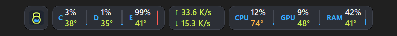
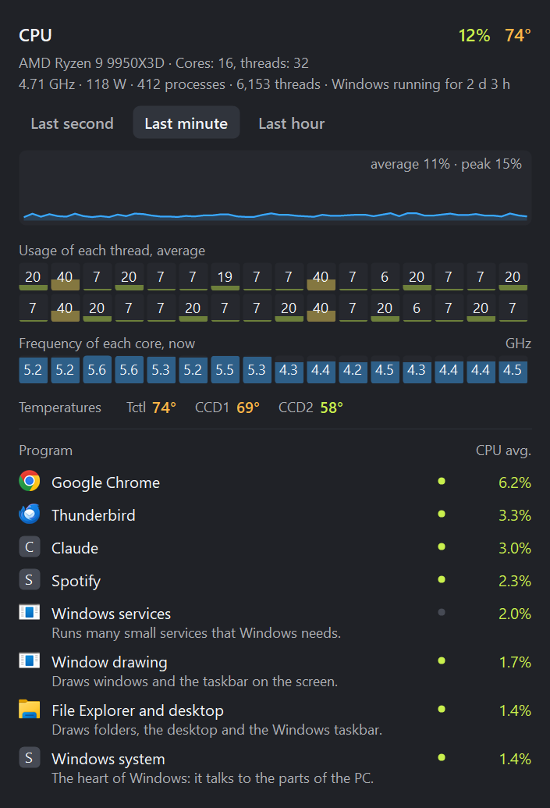
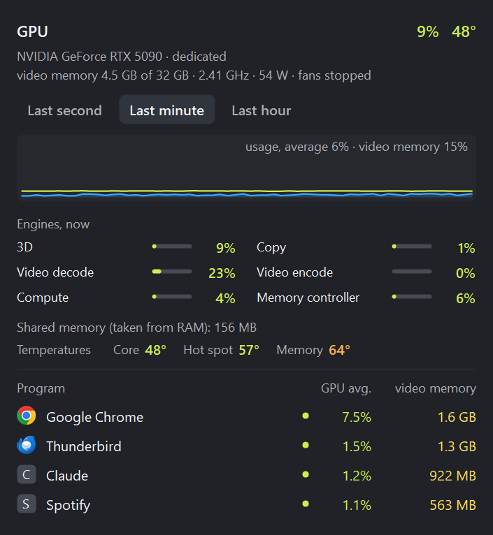
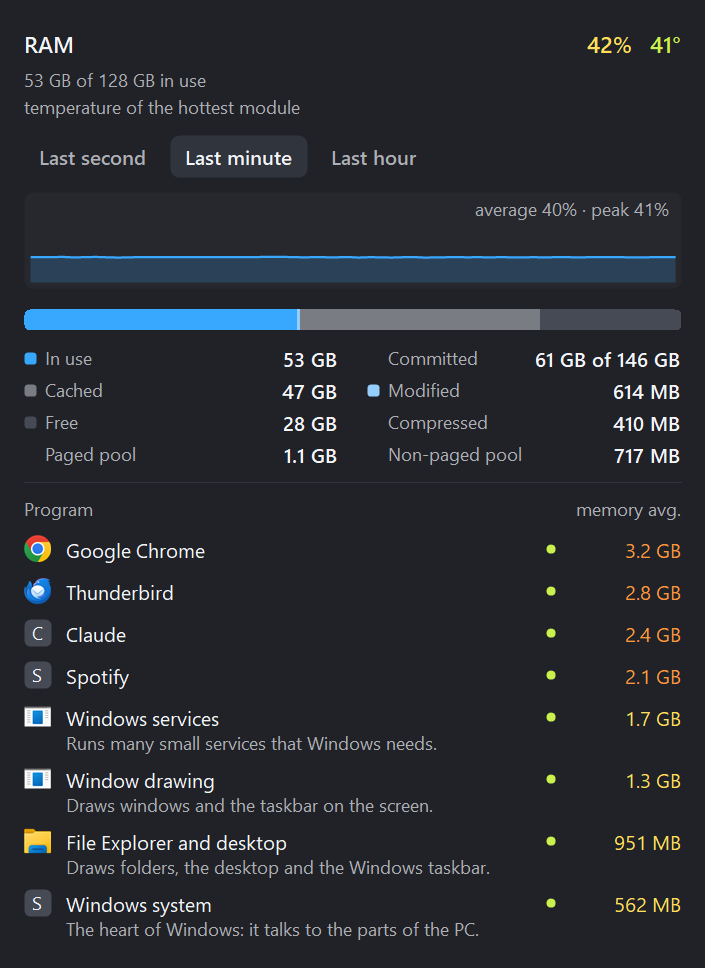
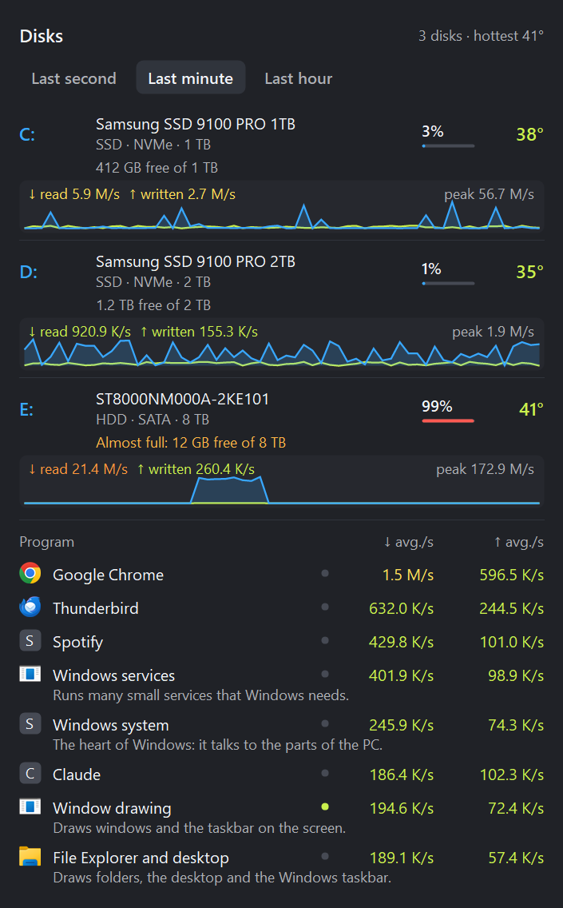
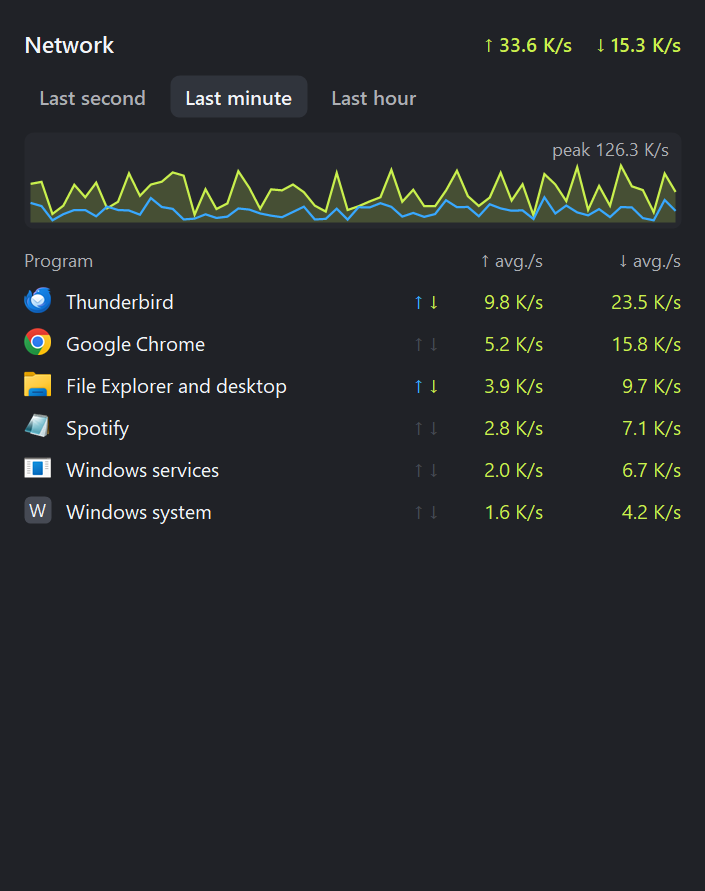
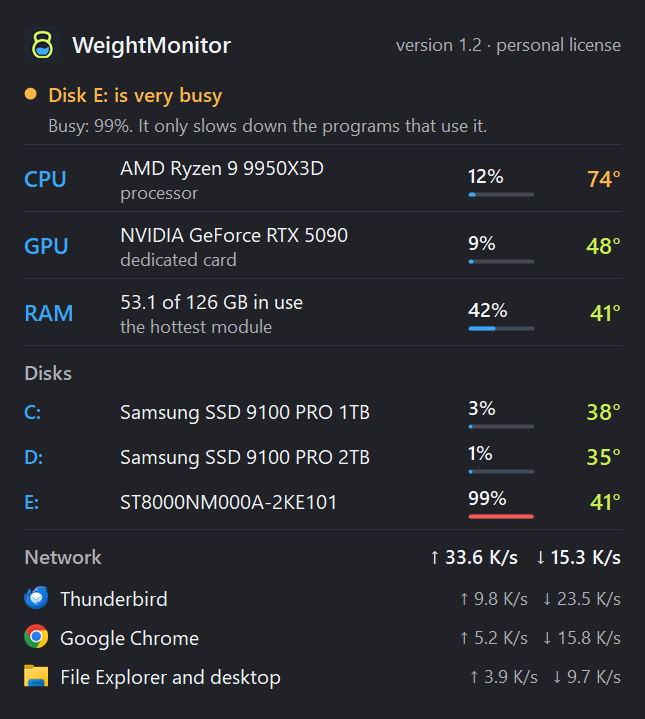
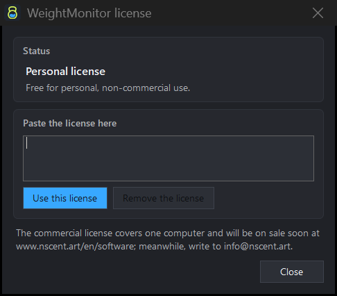

# WeightMonitor

**English** | [Italiano](docs/it/README.md) | [Français](docs/fr/README.md) | [Español](docs/es/README.md) | [Deutsch](docs/de/README.md)

A dashboard on the Windows 11 taskbar, to the left of the Start button: disks, network, CPU, GPU and RAM, with usage and temperature.
One `.exe`, with all the source code here. It never updates itself: it tells you, and you decide.

[Website and license](https://www.nscent.art/en/software)

## To download the program, [click here](https://github.com/nscentart/WeightMonitor/releases/latest/download/WeightMonitor.exe)

You get `WeightMonitor.exe`: open it and choose whether to install it. The link always points to the latest version; older ones
are on the [Releases](https://github.com/nscentart/WeightMonitor/releases) page.
At startup the program checks whether there is a new version and tells you; you can also right-click the icon and choose "Check for updates".



## What it does
- **Tells you right away how the PC is doing**: a sentence at the top of the overview says "The PC is fine" or what is making it struggle.
  It only says the PC is struggling if the strain lasts: a spike of a few seconds is not an alarm. Disks count too: the Windows disk counts
  as much as the processor, while a busy data disk is reported without saying the whole PC is struggling, because it only slows down the programs using it.
- **Checks the hardware at every startup**: CPU, dedicated GPU (or the integrated one if there is no card), RAM modules with a
  sensor, and all disks with their type (SSD/HDD), bus, size and drive letters. The list stays in memory.
- **Adapts to the available space**: when space runs short, the disks merge into a single item, then only the logo remains.
  In **compact mode** only the logo is ever shown. In Settings you choose which parts to show, and your choice is remembered.
- **Five languages**: Italian, English, French, Spanish and German. The installer suggests the Windows language, and you can change it in Settings.
- **Readable on a light Windows taskbar too**: the Classic style puts a dark panel behind the numbers.
- **Detached from the taskbar**: it becomes a floating window you can drag anywhere with the left mouse button. It remembers its position, stays above
  normal windows but below Win+Shift+S and the Start menu, and disappears in full screen just like the docked bar.
- **Click a part of the bar**: a flyout opens, like the one for the Windows hidden icons.
  - CPU: usage of each thread, frequencies, temperatures and the programs using it most.
  - GPU: usage of each engine, video memory, temperatures and the programs using it most.
  - RAM: in use, cached and free, and the programs holding the most.
  - Disks: name, type, temperature and free space of each one, reads and writes, and the programs reading and writing.
  - Network: a graph and **which program is using the connection**. Speed is shown in color (green, yellow, orange, red). The
    flyout always has the same height in all three tabs: with many programs the list scrolls, with the mouse wheel or with
    the scroll bar on the right, and each row keeps its Close button.
  - Logo: everything together.
  - Last second, last minute, last hour: **each flyout remembers its tab**, even after a restart. The flyout
    never covers the detached bar: it opens above or below, and if there is no room it gets shorter or moves aside. If it is taller than the
    screen it scrolls, with the mouse wheel or the arrow keys, so the programs at the bottom stay within reach.
  - Common Windows programs have a clear name and a line explaining what they do, for example "Windows services".
- **Close button on a program's row**: it always asks for confirmation, with the program's name and a warning that unsaved
  work may be lost. It closes the program gently, like the X on its window: if the program has something to save it usually
  asks you itself, and if it doesn't close, WeightMonitor just says so and never forces it. The button doesn't appear on
  Windows programs, system processes, other users' processes, WeightMonitor itself or programs without an open
  window. Right before closing, it checks again that it is still the same program.
- **Notifications**: a short notice when the PC is struggling, in plain words, with the culprit and what you can do. For
  example: "Chrome is using 62% of the processor. The PC may slow down. If you don't need it, close it." The program
  never closes anything by itself. It also warns when the processor or graphics card stay very hot (97 and 90 degrees respectively for a
  minute: high thresholds on purpose, because every processor has its own limits) and when a disk is almost full. No sounds, and silence during games, in full screen, with the taskbar hidden or with Do Not
  Disturb on. The same cause comes back at most once every 30 minutes. Clicking the notification opens that part's flyout; if
  the notification is about a program that can be closed, the click instead opens the same confirmation as the Close button, where you can
  close it, see the details or cancel. You can
  turn notifications off from the menu, under "Notifications", or in Settings.
- **Right-click** the bar or the icon among the hidden icons: a short menu with Settings..., Appearance (compact
  mode, detached from the taskbar), Notifications, **Send error log**, Check for updates and Close.
- **Personal or commercial license**: shown at the top of the overview and at the bottom of Settings; a click on the one in Settings opens the window where you paste the license. It is only a label: every feature stays the same, and the check happens inside the program, with no network.
- **Settings window** (from the menu, or double-click the icon): language, color, dark or light, compact mode, detached from the taskbar, style, show on the taskbar, notifications, update check
  at startup, check the hardware again, open the data folder. With Apply or OK the bar changes at once. If you
  remove it from the taskbar it keeps running among the hidden icons, and a notice says so.
- **Five colors, each dark or light**, for the bar, flyouts and windows: Blue (the main one), Green, Lemon, Pink and Purple, with Automatic following Windows without a restart. You choose them
  in Settings, they take effect with Apply or OK and are kept after updates. Red and orange only ever mean heat and strain, in all themes.
- It disappears by itself during full-screen games and videos.

| CPU | GPU | RAM |
|---|---|---|
|  |  |  |

| Disks | Network | Everything |
|---|---|---|
|  |  |  |

## Installing
1. Download `WeightMonitor.exe` with the link above, into a new, empty folder: when a program starts as administrator, Windows
   can load the files it finds next to it.
2. Open it: you choose **Install** or **Use without installing**.
3. Install asks once for administrator permission, copies the exe to `C:\Program Files\WeightMonitor` and starts it
   at every Windows sign-in.
4. If **PawnIO** isn't already installed, a window first explains what it is and you choose with one of two buttons, neither
   preselected: "Yes, install it: I'll see the temperatures" or "No: no CPU, RAM or disk temperatures". PawnIO is a system-level
   driver: it stays installed even when you remove WeightMonitor, and some game anti-cheat systems may not like it.

To remove it, go to "Settings > Apps > Installed apps".

Windows may warn you at first launch: see [below](#why-windows-or-your-antivirus-may-warn-you) for what that means and
how to check the file.

### Using it without installing
**Use without installing** runs from where it is and asks for no permissions. Temperatures stay "--" and you can't see which
program is using the network and disks: to see them, install it. If you manually run a non-installed copy as administrator it still works,
but it's a risk: its settings and its log stay in the user folder, where any program can
write, and Windows can load the files it finds next to the exe. If you want those permissions, it's better to install.

## Why Windows or your antivirus may warn you
**The exe has no code-signing certificate**: a certificate has to be paid for every year and says who made the program, not
that the program is safe. Without a certificate, Windows doesn't know who the author is and warns you at first.

**What you may see**
- The blue window "Windows protected your PC". It means "I don't know this file", not "I found a virus". To
  continue: **More info**, then **Run anyway**. The warning may come back with each new version.
- "Unknown publisher" when Windows asks for administrator permission.
- With Windows 11 Smart App Control on, the program is blocked with no choice. We don't recommend turning it off just
  for WeightMonitor: if you keep it on, this program is not for you.

**Why some antivirus programs may get suspicious.** We can't promise that none will. To do its job
WeightMonitor asks for administrator rights, starts at sign-in with a scheduled task, reads which programs are using the network and disks and, if
you ask, downloads and installs the PawnIO driver. These are normal things for a system monitor, but they also resemble what
malicious programs do.

**If your antivirus flags it**, you don't need to turn it off. Check the hash as explained below and
[open an issue](https://github.com/nscentart/WeightMonitor/issues) with the antivirus name and the text of
the warning. If you don't trust it, don't install it: that's the right choice.

**How to check the file**
1. Download it only from this page: this is the only official WeightMonitor.
2. Open PowerShell in the file's folder and type: `Get-FileHash .\WeightMonitor.exe -Algorithm SHA256`
3. The result must be identical to the SHA-256 hash written in the release.

If it is identical, you have the file we published. This doesn't prove it's free of defects: for that there's the code,
which you can read here.

## Updating
WeightMonitor never downloads or installs anything by itself. It only checks: if there's a new version it tells you and, when you
click "Open the version page", opens its GitHub page in the browser, where you see what changed and how the code compares
with the previous version. To update:
1. From that page download `WeightMonitor.exe`, into a new, empty folder.
2. Open it and choose **Install**: it closes the old version, takes its place and restarts. Your choices are kept.

The notice window also shows the SHA-256 fingerprint of the new exe, on a fixed line above the notes: select it and compare it with the one of the file you download, as explained in "How to check the file". If GitHub and the notes disagree, the window warns in red not to use that file; if no fingerprint is given, it says so and points to the version page. The program only shows the fingerprint: it downloads and compares nothing by itself.

If you use the program without installing it, just run the new exe instead of the old one. You can turn the check off in Settings;
even with it off, the latest version is always at the link at the top of this page.

## Requirements
- Windows 10 or 11, 64-bit (x64). .NET Framework 4.7.2 or later, already part of Windows.
- Temperatures need administrator rights and the PawnIO driver, as with any program of this kind.

## What it touches, for transparency
- **Internet**: a single question to GitHub at startup, "is there a newer version?" (you can turn it off in Settings). The
  answer is only used to notify you: the browser only ever opens a page of the official repo, whatever the
  answer says, and the program downloads no update. There is also the download of PawnIO during installation, if you
  choose it. Before starting it, the program checks that the digital signature is valid and belongs to namazso, the author of PawnIO.
- **Network per program**: it reads from the Windows kernel event log (ETW, `Microsoft-Windows-Kernel-Network`)
  only the program and the byte count of each packet. Never the content, never the addresses. The history stays in memory and
  disappears when the program closes.
- **Notifications**: they use the numbers the program already has, they don't leave the PC, and the log only records that a
  notice was sent, without the program's name.
- **Files**: in `C:\Program Files\WeightMonitor\data` when installed; when portable or without permissions, in
  `%LOCALAPPDATA%\WeightMonitor`. They hold only `settings.ini` (the choices made in the program), `license.txt` (the commercial license, if you pasted one) and `WeightMonitor.log`
  (errors, crashes, notifications sent and the reasons it hid from the bar; 256 KB at most). Everything else lives in memory and
  disappears when the program closes. The files that versions 1.0 and 1.1 wrote (`dati`, `impostazioni.ini`, `licenza.txt`) are read once, when the new ones are missing, and the program never changes or deletes them while it runs.
- **Error log**: "Send error log" shows the whole report, with user name, computer name and file paths
  already removed (hardware models remain), and opens a pre-filled issue in this repo in the browser. You send
  it, with your account, and **the issue is public**: the program sends nothing by itself.
- **System**: a "WeightMonitor" scheduled task at sign-in, the entry in "Installed apps" and the Start menu shortcut
  for all users (if the program is already running it opens Settings, without starting a second copy). Nothing else.

## Building from scratch
You may compile it from this source for personal use. All you need is Windows: the .NET Framework 4 C# compiler is already part of the system.
```powershell
powershell -NoProfile -ExecutionPolicy Bypass -File scripts/libraries.ps1   # LibreHardwareMonitor 0.9.6, hash verified
powershell -NoProfile -ExecutionPolicy Bypass -File scripts/build.ps1    # bin\WeightMonitor.exe
```
The hash will differ from the release's, and that's normal: the compiler writes the date and a new code into the file at
every build.

An option that doesn't exist, or is missing its value, starts nothing: the program exits with code 2 and, if there is
`--result file`, writes the reason there.

Tests without installing: `WeightMonitor.exe --screenshot test.png --sample [--view extended|collected|compact]
[--flyout cpu|gpu|ram|disks|network|all] [--tab 0|1|2]`, `--screenshot-settings test.png [--scale 1.5]`, `--screenshot-menu test.png`, `--screenshot-welcome test.png [--without-pawnio]`, `--screenshot-pawnio test.png`,
`--screenshot-update test.png`, with `--flyout` also `--screen-height 400 --scroll 200` (a flyout taller than the screen) and `--programs 40` (how many programs in the Network flyout),
`--language it|en|fr|es|de --color blue|green|lemon|pink|purple --appearance auto|dark|light` (with any picture: they apply only that one time and are not saved), `--close-button` (the Close button on the sample programs in sample pictures), `--test-themes [--result file]` (every theme is complete, readable and remembered, and a nonsense value breaks nothing),
`--test-notifications [--result file]` (fake data: writes which notifications would fire and their text, without showing them), `--test-flyouts [--result file]` (where flyouts open and how they scroll), `--test-disks [--result file]` (a fake change on the real disk counters), `--test-etw [--result file]` (per-program reading, actually interrupted on a separate session: needs administrator rights), `--test-close [--result file]` (the Close button on a fake list of programs: which programs stay excluded and the reused process number. It closes nothing), `--test-languages [--result file]` (the texts of the five languages), `--test-license [--result file]` (the license with a test key created in memory, and the labels in the five languages), `--screenshot-license test.png [--holder name] [--message other|revoked|invalid|unreadable|active|removed]` (the license window; with every photo `--holder` shows an example commercial license, and the real license file is never shown), `--screenshot-confirm test.png [--windows 3] [--details]`, with `--flyout` also `--close-button`, with `--screenshot` also `--background light`, `--sentence yes`, `--show cpu,ram`, `--test-security [--result file] [--signature file]` (moving the settings, addresses, update check, PawnIO choice, restarting the reading, cleaning the report, command-line options), `--test-migration --data folder [--result file]` (the settings, license and logs written by versions 1.0 and 1.1, read from the sample files in `tests/legacy-data`), `--test-capture` (with a capture open, it logs what is at
each point of the bar, whether the tooltip shows and which cursor is displayed), or `--preview` (floating
above the bar).

## The code
Source files, file names and option names are in English; the interface and the documentation come in five languages.
- `src/Sensors.cs`: the inventory and sensor reading, on its own thread.
- `src/Network.cs`: who uses the network, via ETW.
- `src/Details.cs`: the numbers of the flyouts and their histories.
- `src/Drawing.cs`, `src/Drawing.Flyouts.cs`, `src/Flyout.cs`: the bar and the flyouts.
- `src/Notifications.cs`, `src/Health.cs`, `src/Sentence.cs`: the notices when the PC is struggling and the sentence at the top of the overview.
- `src/Explanations.cs`: a clear name and a plain-language line for common Windows programs.
- `src/ProgramCloser.cs`: the Close button, with its exclusions and the confirmation.
- `src/License.cs`, `src/LicenseWindow.cs`: checking the license text and its window. Only labels: no feature depends on them.
- `src/Program.cs`: startup, icon, the bar docked to the Windows taskbar, the flyouts.
- `src/SettingsWindow.cs`: the Settings window.
- `src/Language.cs` and `locales/`: the five languages. `src/Theme.cs`: the colors.
- `src/Installer.cs`: installation, PawnIO, uninstallation.
- `src/ErrorReport.cs`: the error report.
- `src/UpdateChecker.cs`: checks whether there is a new version and opens its page.
- `src/Tests/`: the tests, run by `scripts/test.ps1`. `tests/legacy-data/`: sample files from versions 1.0 and 1.1 for the migration test.
- `scripts/`: `build.ps1`, `libraries.ps1`, `test.ps1`, `update.ps1` and `screenshots.ps1`, which regenerates the pictures in `docs/` from the build.

Versions are in [CHANGELOG.md](CHANGELOG.md); third-party parts in [THIRD-PARTY-NOTICES.md](docs/THIRD-PARTY-NOTICES.md).

## License
[PolyForm Strict 1.0.0](LICENSE.md): WeightMonitor is free to use for personal, noncommercial purposes,
and the code can be read. It can't be modified, redistributed or republished, not even as a copy or "fork" on
another site. The only official WeightMonitor is the one downloaded from this page. Commercial use requires a one-time
payment, with one license for each computer, numbered (CompanyName_01, CompanyName_02...): the commercial license will be on sale soon at [nscent.art](https://www.nscent.art/en/software); meanwhile, write to info@nscent.art. Third-party parts remain under their own licenses: [THIRD-PARTY-NOTICES.md](docs/THIRD-PARTY-NOTICES.md).

The license window:


