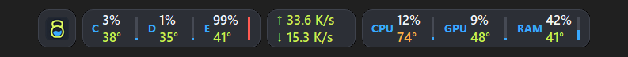
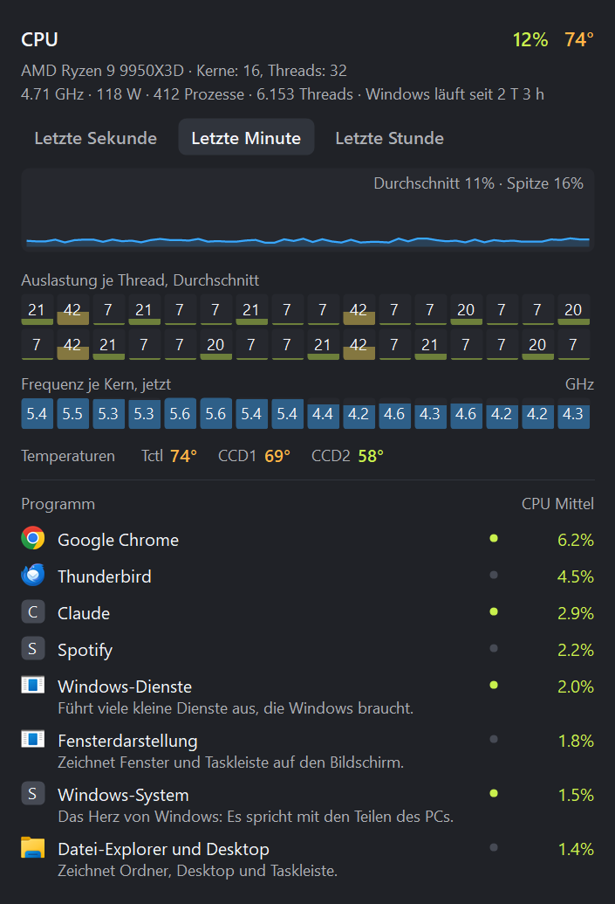
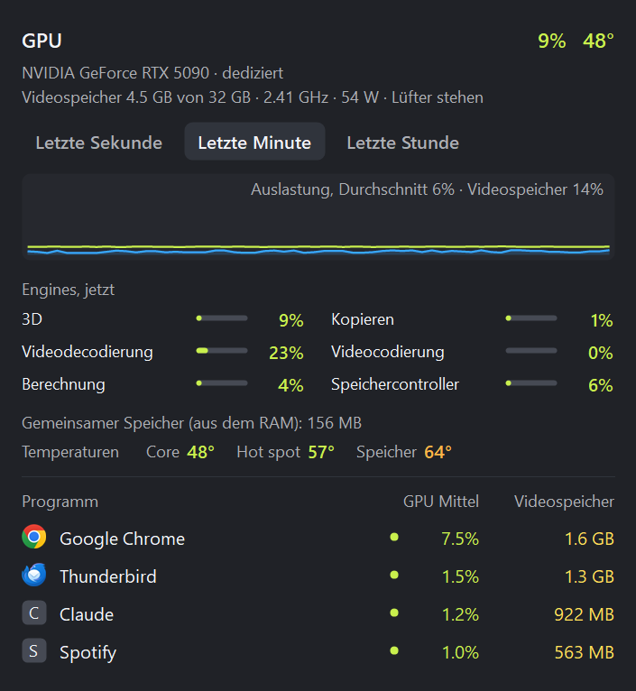
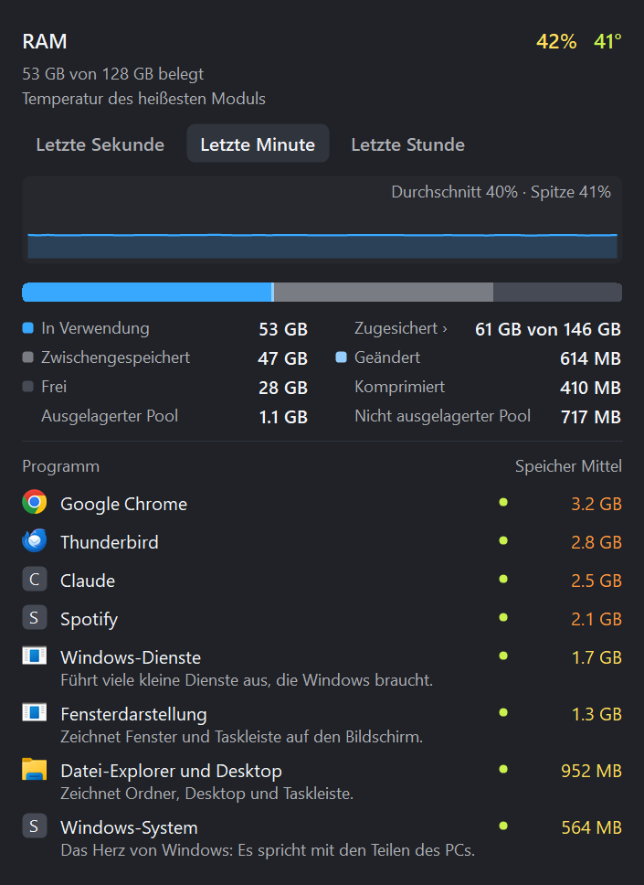
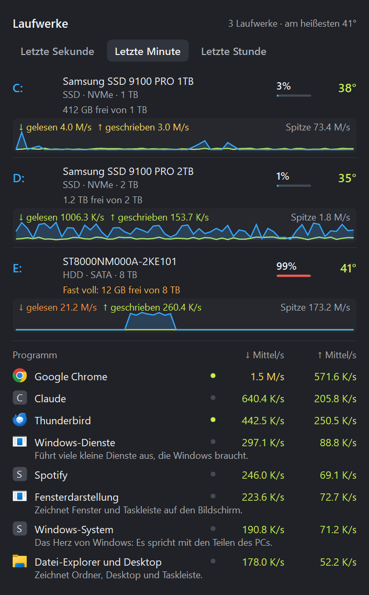
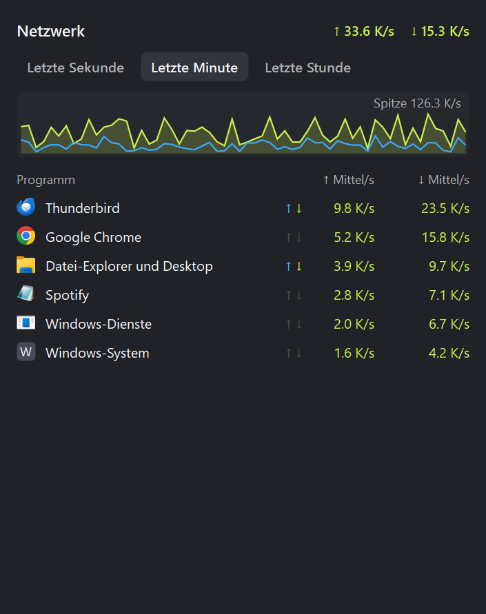
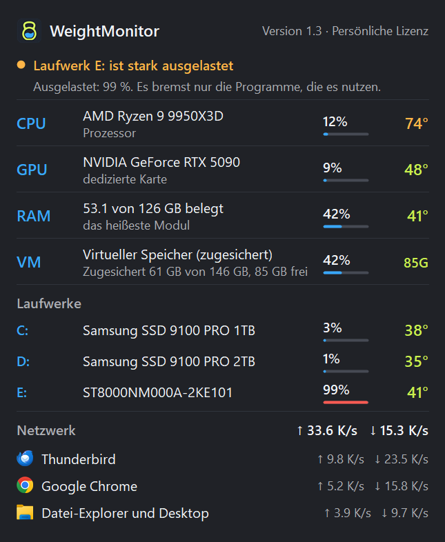
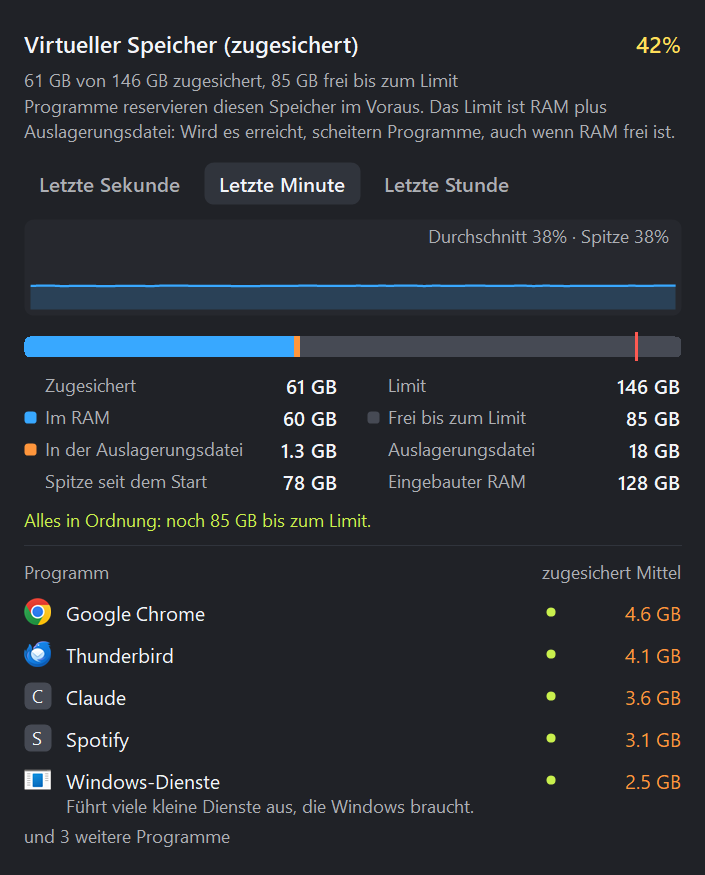
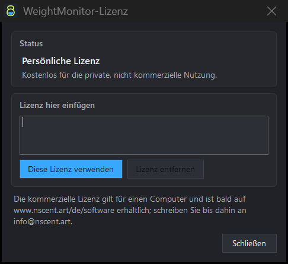

# WeightMonitor

[English](../../README.md) | [Italiano](../it/README.md) | [Français](../fr/README.md) | [Español](../es/README.md) | **Deutsch**

Ein Dashboard in der Taskleiste von Windows 11, links neben der Schaltfläche „Start“: Laufwerke, Netzwerk, CPU, GPU und RAM, mit Auslastung und Temperatur.
Eine einzige `.exe`-Datei, der gesamte Quellcode liegt hier. Das Programm aktualisiert sich nie von selbst: Es informiert Sie, und Sie entscheiden.

[Website und Lizenz](https://www.nscent.art/de/software)

## Um das Programm herunterzuladen, [klicken Sie hier](https://github.com/nscentart/WeightMonitor/releases/latest/download/WeightMonitor.exe)

Sie erhalten `WeightMonitor.exe`: Öffnen Sie die Datei und entscheiden Sie, ob Sie das Programm installieren möchten. Der Link führt immer zur neuesten Version; ältere
finden Sie auf der Seite [Releases](https://github.com/nscentart/WeightMonitor/releases).
Beim Start prüft das Programm, ob es eine neue Version gibt, und teilt es Ihnen mit. Sie können auch mit der rechten Maustaste auf das Symbol klicken und „Nach Updates suchen“ wählen.



## Was es kann
- **Zeigt sofort, wie es dem PC geht**: Oben in der Übersicht steht ein Satz: entweder „Dem PC geht es gut“ oder wer ihn gerade belastet.
  Eine Überlastung meldet es nur, wenn sie anhält: Eine Spitze von wenigen Sekunden ist kein Alarm. Auch die Laufwerke zählen: Das Windows-Laufwerk fällt
  genauso ins Gewicht wie der Prozessor. Ein ausgelastetes Datenlaufwerk wird dagegen gemeldet, ohne dass es heißt, der ganze PC sei überlastet, denn es bremst nur die Programme, die es nutzen.
- **Prüft die Hardware bei jedem Start**: CPU, dedizierte GPU (oder die integrierte, wenn keine Karte vorhanden ist), RAM-Module mit
  Sensor, alle Laufwerke mit SSD/HDD, Bus, Größe und Laufwerksbuchstaben. Die Liste bleibt im Arbeitsspeicher.
- **Passt sich dem Platz an**: Wird der Platz knapp, fasst es die Laufwerke zu einem einzigen Eintrag zusammen, danach bleibt nur noch das Logo.
  Im **Kompaktmodus** bleibt immer nur das Logo. In den Einstellungen wählen Sie, welche Teile angezeigt werden, und die Auswahl bleibt erhalten.
- **Fünf Sprachen**: Italienisch, Englisch, Französisch, Spanisch und Deutsch. Bei der Installation schlägt es die Windows-Sprache vor; ändern lässt sie sich in den Einstellungen.
- **Auch auf einer hellen Windows-Taskleiste lesbar**: Der Stil „Klassisch“ legt eine dunkle Fläche unter die Zahlen.
- **Von der Taskleiste gelöst**: Die Leiste wird zu einem freien Fenster, das Sie mit der linken Maustaste an jede beliebige Stelle ziehen. Sie merkt sich die Position, bleibt über
  normalen Fenstern, aber unter Win+Umschalt+S und dem Startmenü, und verschwindet im Vollbild genau wie die angedockte Leiste.
- **Klick auf einen Teil der Leiste**: Ein Flyout öffnet sich, wie bei den ausgeblendeten Symbolen von Windows.
  - CPU: Auslastung jedes Threads, Frequenzen, Temperaturen und die Programme, die sie am stärksten nutzen.
  - GPU: Auslastung jeder Engine, Videospeicher, Temperaturen und die Programme, die sie am stärksten nutzen.
  - RAM: verwendet, zwischengespeichert und frei, dazu die Programme, die am meisten davon belegen.
  - Virtueller Speicher (VM): wie viel Speicher die Programme reserviert haben (zugesichert), gemessen am Limit aus RAM plus Auslagerungsdatei, und wie viel bis zum Limit bleibt. Dazu der Teil in der Auslagerungsdatei, die Spitze, ein Diagramm und die Programme, die am meisten reservieren, jedes mit seiner Schaltfläche Schließen. Wenn wenig bleibt, steht es in Rot da, mit dem, was zu tun ist. Es öffnet sich auch über die Zeile „Zugesichert“ im RAM-Fenster und über seine Benachrichtigung.
  - Laufwerke: Name, Typ, Temperatur und freier Speicherplatz jedes Laufwerks, Lese- und Schreibvorgänge, die Programme, die lesen und schreiben.
  - Netzwerk: ein Diagramm und **welches Programm die Verbindung nutzt**. Die Geschwindigkeit ist farbig markiert (grün, gelb, orange, rot). Das
    Flyout ist auf allen drei Registerkarten immer gleich hoch: Bei vielen Programmen lässt sich die Liste scrollen, mit dem Mausrad oder mit
    der Bildlaufleiste rechts, und jede Zeile behält ihre Schaltfläche „Schließen“.
  - Logo: alles zusammen.
  - Letzte Sekunde, Letzte Minute, Letzte Stunde: **Jedes Flyout merkt sich seine Registerkarte**, auch nach einem Neustart. Das Flyout
    verdeckt die gelöste Leiste nie: Es öffnet sich darüber oder darunter und wird, wenn der Platz nicht reicht, kürzer oder rückt zur Seite. Ist es höher als der
    Bildschirm, lässt es sich scrollen, mit dem Mausrad oder den Pfeiltasten: Die Programme ganz unten gehen nicht verloren.
  - Gängige Windows-Programme haben einen verständlichen Namen und eine Zeile, die erklärt, was sie tun, zum Beispiel „Windows-Dienste“.
- **Schaltfläche „Schließen“ in der Zeile eines Programms**: Sie fragt immer nach einer Bestätigung, mit dem Namen des Programms und dem Hinweis, dass nicht gespeicherte
  Arbeit verloren gehen kann. Das Programm wird behutsam geschlossen, wie mit dem X des Fensters: Hat es etwas zu speichern, fragt es Sie meist
  selbst. Schließt es sich nicht, teilt WeightMonitor das nur mit und erzwingt nie etwas. Die Schaltfläche erscheint nicht bei
  Windows-Programmen, Systemprozessen, Prozessen anderer Benutzer, bei WeightMonitor selbst und bei Programmen ohne geöffnetes
  Fenster. Unmittelbar vor dem Schließen prüft WeightMonitor noch einmal, ob es noch dasselbe Programm ist.
- **Benachrichtigungen**: ein kurzer Hinweis, wenn der PC überlastet ist, in einfachen Worten, mit dem Verursacher und dem, was Sie tun können. Zum
  Beispiel: *Das Programm „Chrome“ nutzt 62 % des Prozessors. Der PC könnte langsamer werden. Wenn Sie es nicht brauchen, schließen Sie es.* WeightMonitor
  schließt nie etwas von selbst. Es warnt auch, wenn Prozessor oder Grafikkarte sehr heiß bleiben (97 und 90 Grad eine
  Minute lang: Die Schwellen sind absichtlich hoch, weil jeder Prozessor seine eigenen Grenzen hat), und wenn ein Laufwerk fast voll ist. Es gibt keine Töne, und es bleibt still bei Spielen, im Vollbild, bei ausgeblendeter Taskleiste und bei „Nicht
  stören“. Dieselbe Ursache meldet sich höchstens alle 30 Minuten erneut. Ein Klick auf die Benachrichtigung öffnet das Flyout des betreffenden Teils; geht es in
  der Benachrichtigung um ein Programm, das sich schließen lässt, öffnet der Klick stattdessen dieselbe Bestätigung wie die Schaltfläche „Schließen“. Dort können Sie
  es schließen, die Details ansehen oder abbrechen. Ausschalten lassen sich
  die Benachrichtigungen im Menü unter „Benachrichtigungen“ oder in den Einstellungen.
- **Rechtsklick** auf die Leiste oder auf das Symbol bei den ausgeblendeten Symbolen: ein kurzes Menü mit Einstellungen..., Darstellung (Kompaktmodus,
  Von der Taskleiste gelöst), Benachrichtigungen, **Fehlerprotokoll senden**, Nach Updates suchen und Schließen.
- **Persönliche oder kommerzielle Lizenz**: Der Hinweis steht oben in der Übersicht und unten in den Einstellungen; ein Klick auf den Hinweis in den Einstellungen öffnet das Fenster, in das Sie die Lizenz einfügen. Es ist nur ein Hinweis: Alle Funktionen bleiben gleich, und die Prüfung erfolgt im Programm, ohne Netzwerk.
- **Fenster „Einstellungen“** (über das Menü oder per Doppelklick auf das Symbol): Sprache, Farbe, Dunkel oder hell, Kompaktmodus, Von der Taskleiste gelöst, Stil, In der Taskleiste anzeigen, Benachrichtigungen, Beim Start nach einer neuen
  Version suchen, Hardware erneut prüfen, Datenordner öffnen. Mit Übernehmen oder OK ändert sich die Leiste sofort. Entfernen Sie
  sie aus der Taskleiste, läuft das Programm bei den ausgeblendeten Symbolen weiter, und ein Hinweis teilt Ihnen das mit.
- **Fünf Farben, jede dunkel oder hell**, für Leiste, Flyouts und Fenster: Blau (die Hauptfarbe), Grün, Zitrone, Rosa und Violett, dazu Automatisch, das ohne Neustart Windows folgt. Sie wählen sie
  in den Einstellungen, sie gelten mit Übernehmen oder OK und bleiben nach Updates erhalten. Rot und Orange stehen in allen Designs nur für Hitze und Belastung.
- Es verschwindet von selbst bei Spielen und Videos im Vollbild.

| CPU | GPU | RAM |
|---|---|---|
|  |  |  |

| Laufwerke | Netzwerk | Alles |
|---|---|---|
|  |  |  |

| Virtueller Speicher (zugesichert) |
|---|
|  |

## Installation
1. Laden Sie `WeightMonitor.exe` über den Link oben in einen neuen, leeren Ordner herunter: Wenn ein Programm als Administrator startet, kann Windows
   die Dateien laden, die es daneben findet.
2. Öffnen Sie die Datei: Sie wählen **Installieren** oder **Ohne Installation nutzen**.
3. **Installieren** fragt einmal nach Administratorrechten, kopiert die EXE-Datei nach `C:\Program Files\WeightMonitor` und startet sie
   bei jeder Windows-Anmeldung.
4. Ist **PawnIO** noch nicht vorhanden, erklärt vor der Installation ein Fenster, worum es sich handelt, und Sie entscheiden mit zwei Schaltflächen, von denen keine
   vorausgewählt ist: „Ja, installieren: Ich sehe die Temperaturen“ oder „Nein: keine Temperaturen von CPU, RAM und Laufwerken“. PawnIO ist ein Treiber auf
   Systemebene: Er bleibt installiert, auch wenn Sie WeightMonitor entfernen, und manche Anti-Cheat-Programme von Spielen können sich daran stören.

Entfernen lässt sich das Programm unter „Einstellungen > Installierte Apps“.

Windows warnt möglicherweise beim ersten Start: [Weiter unten](#warum-windows-oder-ihr-virenschutz-sie-warnen-kann) steht, was das bedeutet und
wie Sie die Datei prüfen.

### Ohne Installation nutzen
**Ohne Installation nutzen** startet von dort, wo die Datei liegt, und fragt nach keinen Berechtigungen. Die Temperaturen bleiben bei „--“, und Sie sehen nicht, welches
Programm Netzwerk und Laufwerke nutzt: Dafür müssen Sie es installieren. Starten Sie eine nicht installierte Kopie von Hand als Administrator, funktioniert sie
trotzdem, aber das ist riskant: Die Einstellungen und das Protokoll dieser Kopie bleiben im Benutzerordner, in den jedes Programm schreiben
kann, und Windows kann die Dateien laden, die es neben der EXE-Datei findet. Wenn Sie diese Rechte möchten, installieren Sie das Programm lieber.

## Warum Windows oder Ihr Virenschutz Sie warnen kann
**Die EXE-Datei hat kein Windows-Zertifikat**: Ein Zertifikat kostet jedes Jahr Geld und sagt aus, wer das Programm erstellt hat, nicht,
dass das Programm sicher ist. Ohne Zertifikat weiß Windows nicht, wer der Autor ist, und warnt zunächst.

**Was Sie sehen können**
- Das blaue Fenster „Der Computer wurde durch Windows geschützt“. Es bedeutet „Ich kenne diese Datei nicht“, nicht „Ich habe einen Virus gefunden“.
  Zum Fortfahren: **Weitere Informationen**, dann **Trotzdem ausführen**. Die Warnung kann bei jeder neuen Version wiederkommen.
- Der Hinweis auf einen „unbekannten Herausgeber“, wenn Windows nach Administratorrechten fragt.
- Ist die Intelligente App-Steuerung (Smart App Control) von Windows 11 eingeschaltet, wird das Programm ohne Wahlmöglichkeit blockiert. Wir raten davon ab, sie nur
  wegen WeightMonitor auszuschalten: Wenn Sie sie eingeschaltet lassen, ist dieses Programm nichts für Sie.

**Warum manche Virenschutzprogramme misstrauisch werden können.** Wir können nicht versprechen, dass das bei keinem passiert. Für seine Arbeit
verlangt WeightMonitor Administratorrechte, startet bei der Anmeldung über eine geplante Aufgabe, liest aus, wer Netzwerk und Laufwerke nutzt, und lädt auf
Ihren Wunsch den PawnIO-Treiber herunter und installiert ihn. Das ist für einen Systemmonitor normal, ähnelt aber auch dem, was
schädliche Programme tun.

**Wenn Ihr Virenschutz das Programm meldet**, müssen Sie ihn nicht ausschalten. Prüfen Sie den Hash wie unten beschrieben und
[eröffnen Sie eine Meldung (Issue)](https://github.com/nscentart/WeightMonitor/issues) mit dem Namen des Virenschutzes und dem Text
der Warnung. Wenn Sie dem Programm nicht vertrauen, installieren Sie es nicht: Das ist die richtige Entscheidung.

**So prüfen Sie die Datei**
1. Laden Sie sie nur von dieser Seite herunter: Dies ist das einzige offizielle WeightMonitor.
2. Öffnen Sie PowerShell im Ordner der Datei und geben Sie ein: `Get-FileHash .\WeightMonitor.exe -Algorithm SHA256`
3. Das Ergebnis muss genau mit dem SHA-256-Hash übereinstimmen, der im Release angegeben ist.

Stimmt es überein, haben Sie die Datei, die wir veröffentlicht haben. Das beweist nicht, dass sie frei von Fehlern ist: Dafür gibt es den Code,
den Sie hier lesen können.

## Aktualisieren
WeightMonitor lädt nie etwas von selbst herunter und installiert auch nichts. Es prüft nur: Gibt es eine neue Version, teilt es Ihnen das mit und öffnet, wenn Sie
auf „Versionsseite öffnen“ klicken, deren GitHub-Seite im Browser. Dort sehen Sie, was sich geändert hat und wie sich der Code vom
bisherigen unterscheidet. So aktualisieren Sie:
1. Laden Sie von dieser Seite `WeightMonitor.exe` in einen neuen, leeren Ordner herunter.
2. Öffnen Sie die Datei und wählen Sie **Installieren**: Die alte Version wird beendet und ersetzt, und das Programm startet neu. Ihre Einstellungen bleiben erhalten.

Das Hinweisfenster zeigt außerdem den SHA-256-Fingerabdruck der neuen exe in einer festen Zeile über den Hinweisen: Markieren Sie ihn und vergleichen Sie ihn mit dem der heruntergeladenen Datei, wie unter „So prüfen Sie die Datei“ beschrieben. Stimmen GitHub und die Hinweise nicht überein, warnt das Fenster in Rot davor, diese Datei zu verwenden; ist kein Fingerabdruck angegeben, sagt es das und verweist auf die Versionsseite. Das Programm zeigt den Fingerabdruck nur an: Es lädt und vergleicht nichts von selbst.

Nutzen Sie die Kopie ohne Installation, verwenden Sie einfach die neue EXE-Datei statt der alten. Die Prüfung lässt sich in den Einstellungen ausschalten;
auch dann finden Sie die neueste Version immer über den Link oben auf dieser Seite.

## Voraussetzungen
- Windows 10 oder 11, 64 Bit (x64). .NET Framework 4.7.2 oder höher, das bereits zu Windows gehört.
- Für die Temperaturen sind Administratorrechte und der PawnIO-Treiber nötig, wie bei jedem Programm dieser Art.

## Der Transparenz halber: worauf das Programm zugreift
- **Internet**: beim Start eine einzige Anfrage an GitHub: „Gibt es eine neuere Version?“ (lässt sich in den Einstellungen ausschalten). Die
  Antwort dient nur dazu, Sie zu informieren: Im Browser öffnet sich immer nur eine Seite des offiziellen Repositorys, ganz gleich, was in der
  Antwort steht, und das Programm lädt kein Update herunter. Hinzu kommt der Download von PawnIO während der Installation, wenn Sie
  sich dafür entscheiden. Vor dem Start prüft das Programm, ob die digitale Signatur gültig ist und zu namazso gehört, dem Autor von PawnIO.
- **Netzwerk pro Programm**: Aus dem Ereignisprotokoll des Windows-Kernels (ETW, `Microsoft-Windows-Kernel-Network`) liest es
  nur das Programm und die Bytes jedes Pakets. Nie den Inhalt, nie die Adressen. Der Verlauf bleibt im Arbeitsspeicher und
  verschwindet beim Beenden.
- **Benachrichtigungen**: Sie verwenden die Zahlen, die das Programm ohnehin hat, und verlassen den PC nicht. Im Protokoll steht nur, dass ein
  Hinweis ausgelöst wurde, ohne den Namen des Programms.
- **Dateien**: bei installiertem Programm in `C:\Program Files\WeightMonitor\data`, als portable Version oder ohne Rechte in
  `%LOCALAPPDATA%\WeightMonitor`. Dort liegen nur `settings.ini` (die im Programm getroffene Auswahl), `license.txt` (die kommerzielle Lizenz, falls Sie eine eingefügt haben) und `WeightMonitor.log`
  (Fehler, Abstürze, ausgelöste Benachrichtigungen und die Gründe, warum es sich aus der Taskleiste ausgeblendet hat; höchstens 256 KB). Alles andere liegt im Arbeitsspeicher und
  verschwindet beim Beenden. Die von den Versionen 1.0 und 1.1 geschriebenen Dateien (`dati`, `impostazioni.ini`, `licenza.txt`) werden einmalig gelesen, wenn die neuen fehlen, und das Programm ändert oder löscht sie im Betrieb nie.
- **Fehlerprotokoll**: „Fehlerprotokoll senden“ zeigt den vollständigen Bericht, aus dem Benutzername, Computername und Dateipfade
  bereits entfernt sind (die Hardwaremodelle bleiben), und öffnet im Browser eine vorausgefüllte Meldung (Issue) in diesem Repository. Senden
  müssen Sie sie selbst, mit Ihrem Konto, und **die Meldung ist öffentlich**: Das Programm sendet von sich aus nichts.
- **System**: eine geplante Aufgabe „WeightMonitor“ bei der Anmeldung, der Eintrag unter „Installierte Apps“ und die Startmenü-Verknüpfung
  für alle Benutzer (läuft das Programm bereits, öffnet sie die Einstellungen, ohne eine zweite Kopie zu starten). Sonst nichts.

## Selbst kompilieren
Für die private Nutzung dürfen Sie das Programm aus diesem Quellcode kompilieren. Sie brauchen nur Windows: Der C#-Compiler von .NET Framework 4 ist bereits im System enthalten.
```powershell
powershell -NoProfile -ExecutionPolicy Bypass -File scripts/libraries.ps1   # LibreHardwareMonitor 0.9.6, Hash geprüft
powershell -NoProfile -ExecutionPolicy Bypass -File scripts/build.ps1    # bin\WeightMonitor.exe
```
Der Hash weicht von dem des Release ab, und das ist normal: Der Compiler schreibt bei jedem Kompilieren das Datum und einen neuen Code
in die Datei.

Eine Option, die es nicht gibt oder der ihr Wert fehlt, startet nichts: Das Programm wird mit Code 2 beendet und schreibt, falls
`--result file` angegeben ist, den Grund dorthin.

Tests ohne Installation: `WeightMonitor.exe --screenshot test.png --sample [--view extended|collected|compact]
[--flyout cpu|gpu|ram|commit|disks|network|all] [--tab 0|1|2]`, `--screenshot-settings test.png [--scale 1.5]`, `--screenshot-menu test.png`, `--screenshot-welcome test.png [--without-pawnio]`, `--screenshot-pawnio test.png`,
`--screenshot-update test.png`, mit `--flyout` auch `--screen-height 400 --scroll 200` (ein Flyout, das höher als der Bildschirm ist) und `--programs 40` (wie viele Programme im Flyout „Netzwerk“ stehen),
`--language it|en|fr|es|de --color blue|green|lemon|pink|purple --appearance auto|dark|light` (bei jedem Bild: gelten nur dieses eine Mal und werden nicht gespeichert), `--close-button` (in Beispielbildern die Schaltfläche „Schließen“ bei den Beispielprogrammen), `--test-themes [--result file]` (jedes Design vollständig und lesbar, gemerkt, ein unsinniger Wert macht nichts kaputt),
`--test-notifications [--result file]` (Testdaten: schreibt, welche Benachrichtigungen ausgelöst würden und mit welchem Text, ohne sie anzuzeigen), `--test-flyouts [--result file]` (wo sich Flyouts öffnen und wie sie scrollen), `--test-disks [--result file]` (eine simulierte Änderung an den echten Laufwerkszählern), `--test-etw [--result file]` (das Lesen pro Programm, tatsächlich unterbrochen in einer separaten Sitzung: erfordert Administratorrechte), `--test-close [--result file]` (die Schaltfläche „Schließen“ an einer simulierten Programmliste: wer ausgeschlossen bleibt und die wiederverwendete Prozessnummer. Es wird nichts geschlossen), `--test-languages [--result file]` (die Texte der fünf Sprachen), `--test-license [--result file]` (die Lizenz mit einem im Speicher erzeugten Testschlüssel und die Hinweise in den fünf Sprachen), `--screenshot-license test.png [--holder Name] [--message other|revoked|invalid|unreadable|active|removed]` (das Lizenzfenster; bei jedem Foto zeigt `--holder` eine kommerzielle Beispiellizenz, die echte Lizenzdatei ist nie zu sehen), `--screenshot-confirm test.png [--windows 3] [--details]`, mit `--flyout` auch `--close-button`, mit `--screenshot` auch `--background light`, `--sentence yes`, `--show cpu,ram`, `--test-security [--result file] [--signature file]` (Umzug der Einstellungen, Adressen, Update-Prüfung, PawnIO-Auswahl, Neustart des Lesens, Bereinigung des Berichts, Befehlszeilenoptionen), `--test-migration --data Ordner [--result file]` (die von den Versionen 1.0 und 1.1 geschriebenen Einstellungen, Lizenz und Protokolle, gelesen aus den Beispieldateien in `tests/legacy-data`), `--test-capture` (bei offener Bildschirmaufnahme protokolliert es, was an den Punkten
der Leiste liegt, ob die QuickInfo erscheint und welcher Mauszeiger aktiv ist) oder `--preview` (schwebend
über der Leiste).

## Der Code
Quelldateien, Dateinamen und Optionsnamen sind auf Englisch; Oberfläche und Dokumentation gibt es in fünf Sprachen.
- `src/Sensors.cs`: die Inventarisierung und das Auslesen der Sensoren, in einem eigenen Thread.
- `src/Network.cs`: wer das Netzwerk nutzt, über ETW.
- `src/Details.cs`: die Zahlen der Flyouts und ihre Verläufe.
- `src/Drawing.cs`, `src/Drawing.Flyouts.cs`, `src/Flyout.cs`: die Leiste und die Flyouts.
- `src/Notifications.cs`, `src/Health.cs`, `src/Sentence.cs`: die Hinweise bei Überlastung des PCs und der Satz oben in der Übersicht.
- `src/Explanations.cs`: verständlicher Name und Erklärung in einfachen Worten für gängige Windows-Programme.
- `src/ProgramCloser.cs`: die Schaltfläche „Schließen“ mit ihren Ausschlüssen und der Bestätigung.
- `src/License.cs`, `src/LicenseWindow.cs`: die Prüfung des Lizenztextes und das zugehörige Fenster. Nur Hinweise: Keine Funktion hängt davon ab.
- `src/Program.cs`: Start, Symbol, die an die Windows-Taskleiste angedockte Leiste, die Flyouts.
- `src/SettingsWindow.cs`: das Fenster „Einstellungen“.
- `src/Language.cs` und `locales/`: die fünf Sprachen. `src/Theme.cs`: die Farben.
- `src/Installer.cs`: Installation, PawnIO, Deinstallation.
- `src/ErrorReport.cs`: der Fehlerbericht.
- `src/UpdateChecker.cs`: prüft, ob es eine neue Version gibt, und öffnet deren Seite.
- `src/Tests/`: die Tests, gestartet von `scripts/test.ps1`. `tests/legacy-data/`: Beispieldateien der Versionen 1.0 und 1.1 für den Migrationstest.
- `scripts/`: `build.ps1`, `libraries.ps1`, `test.ps1`, `update.ps1` und `screenshots.ps1`, das die Bilder in `docs/` aus dem Build neu erzeugt.

Die Versionen stehen in [CHANGELOG.md](../../CHANGELOG.md), die Komponenten von Drittanbietern in [THIRD-PARTY-NOTICES.md](../THIRD-PARTY-NOTICES.md).

## Lizenz
[PolyForm Strict 1.0.0](../../LICENSE.md): WeightMonitor darf für private, nicht kommerzielle Zwecke kostenlos genutzt werden,
und der Code darf gelesen werden. Das Programm darf nicht geändert, weitergegeben oder neu veröffentlicht werden, auch nicht als Kopie oder „Fork“ auf
einer anderen Website. Das einzige offizielle WeightMonitor ist das, das von dieser Seite heruntergeladen wird. Die kommerzielle Nutzung ist kostenpflichtig, mit einer
einmaligen Zahlung und einer nummerierten Lizenz pro Computer (Firmenname_01, Firmenname_02...): Die kommerzielle Lizenz ist bald auf [nscent.art](https://www.nscent.art/de/software) erhältlich; schreiben Sie bis dahin an info@nscent.art. Komponenten von Drittanbietern unterliegen weiterhin ihren eigenen Lizenzen: [THIRD-PARTY-NOTICES.md](../THIRD-PARTY-NOTICES.md).

Das Lizenzfenster:


