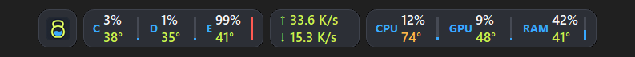
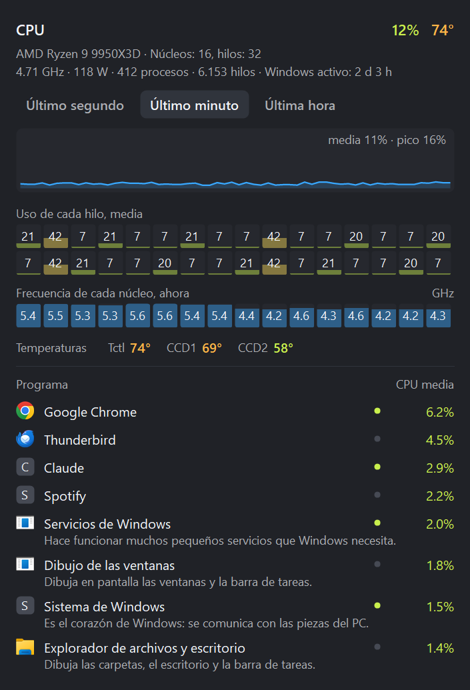
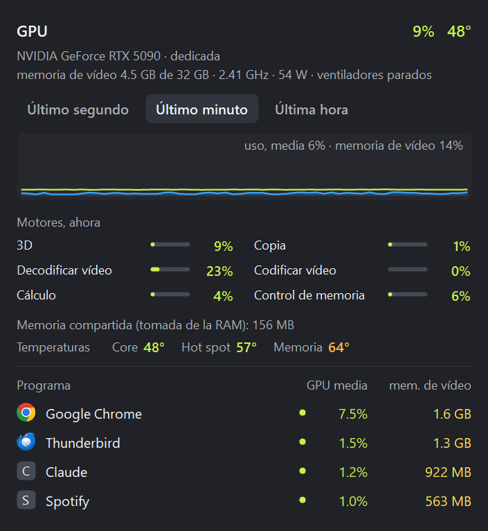
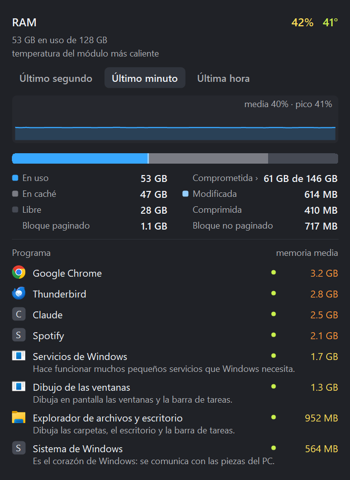
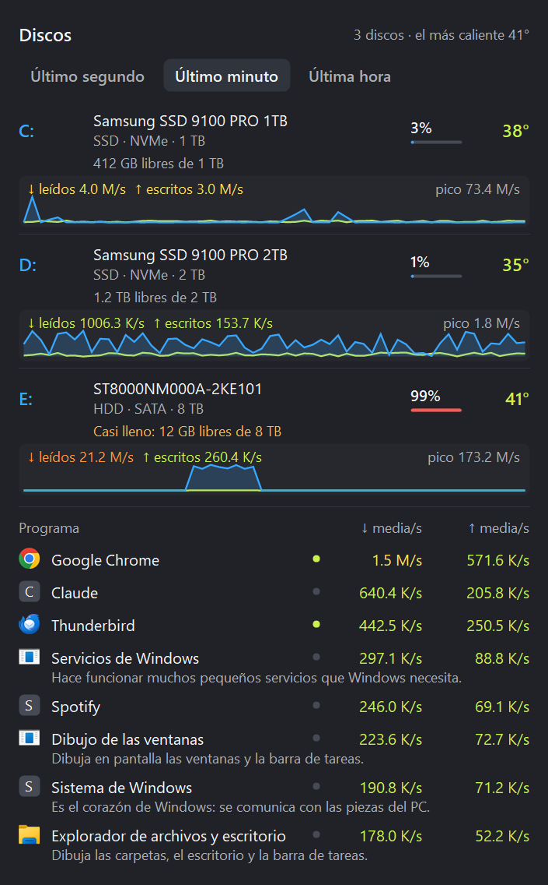
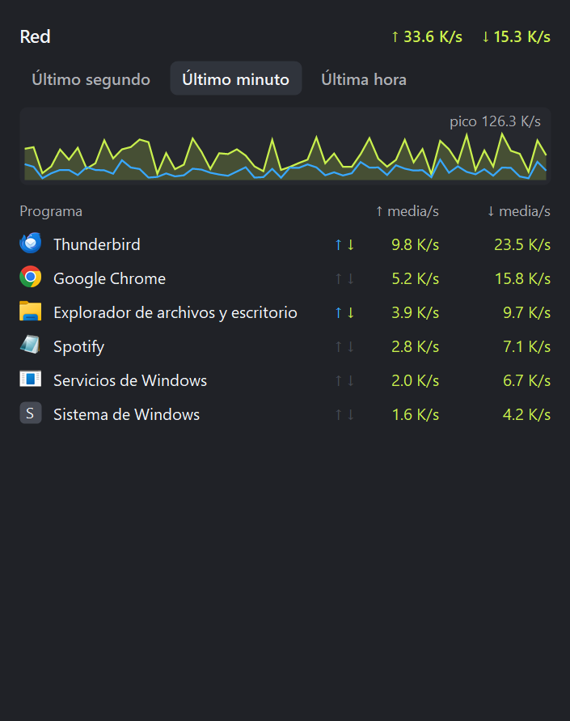
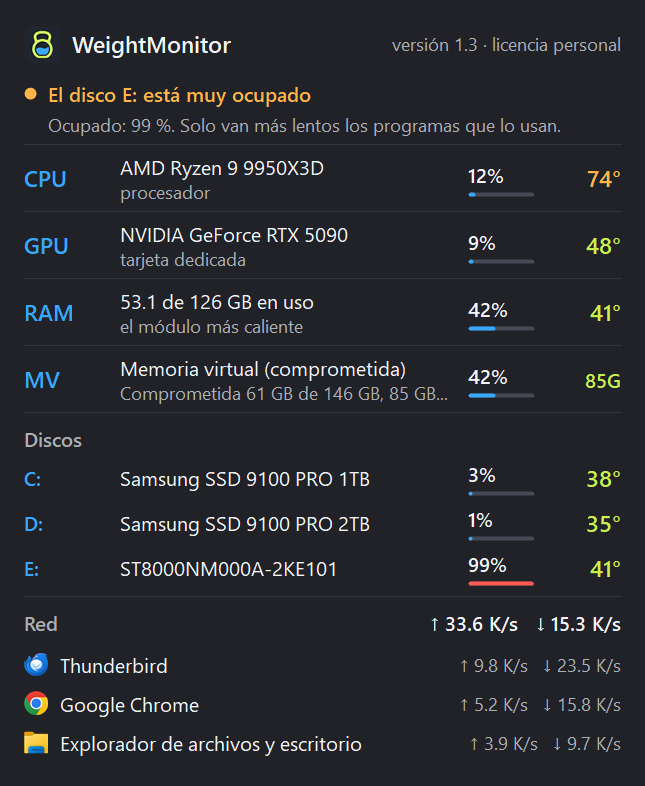
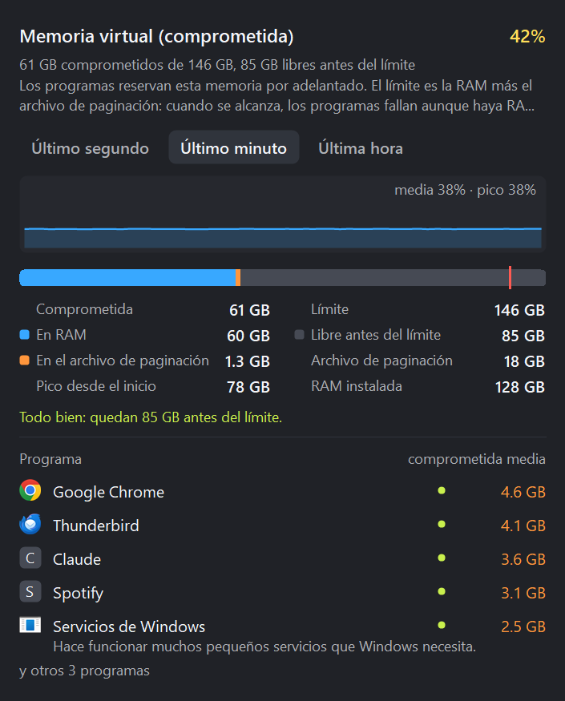
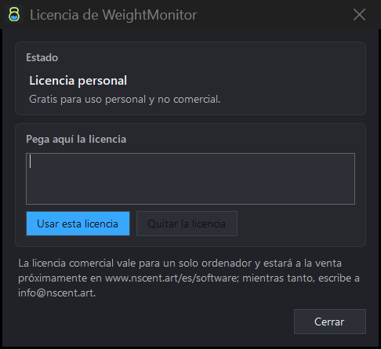

# WeightMonitor

[English](../../README.md) | [Italiano](../it/README.md) | [Français](../fr/README.md) | **Español** | [Deutsch](../de/README.md)

Un panel de indicadores en la barra de tareas de Windows 11, a la izquierda del botón Inicio: discos, red, CPU, GPU y RAM, con uso y temperatura.
Un solo `.exe`, con todo el código fuente aquí. Nunca se actualiza por sí solo: te avisa y tú decides.

[Sitio web y licencia](https://www.nscent.art/es/software)

## Para descargar el programa, [haz clic aquí](https://github.com/nscentart/WeightMonitor/releases/latest/download/WeightMonitor.exe)

Obtienes `WeightMonitor.exe`: ábrelo y elige si quieres instalarlo. El enlace siempre lleva a la última versión; las anteriores
están en la página [Releases](https://github.com/nscentart/WeightMonitor/releases).
Al iniciarse, el programa comprueba si hay una versión nueva y te avisa; también puedes hacer clic derecho en el icono y elegir «Comprobar actualizaciones».



## Qué hace
- **Te dice enseguida cómo está el PC**: en la parte superior de la vista general, una frase dice «El PC está bien» o quién lo está sobrecargando.
  Solo dice que al PC le cuesta trabajar si la situación se mantiene: un pico de unos segundos no es una alarma. También cuentan los discos: el disco de Windows pesa
  tanto como el procesador, mientras que un disco de datos ocupado se indica sin decir que le cuesta a todo el PC, porque solo ralentiza a quien lo usa.
- **Revisa el hardware en cada inicio**: CPU, GPU dedicada (o la integrada si no hay tarjeta), módulos de RAM con
  sensor, todos los discos, con SSD/HDD, bus, tamaño y letras. La lista se queda en memoria.
- **Se adapta al espacio**: cuando falta espacio, los discos se agrupan en un solo elemento y después solo queda el logo.
  En **modo compacto** solo queda el logo, siempre. En Configuración eliges qué partes mostrar, y la elección se conserva.
- **Cinco idiomas**: italiano, inglés, francés, español y alemán. Durante la instalación propone el idioma de Windows, y se puede cambiar en Configuración.
- **Se lee bien también con la barra de tareas de Windows clara**: el estilo Clásico pone una placa oscura debajo de los números.
- **Separada de la barra**: se convierte en una ventana libre que arrastras con el botón izquierdo adonde quieras. Recuerda su posición, se mantiene por encima
  de las ventanas normales, pero por debajo de Win+Mayús+S y del menú Inicio, y desaparece en pantalla completa igual que la acoplada.
- **Clic en una parte de la barra**: se abre un panel desplegable, como los iconos ocultos de Windows.
  - CPU: uso de cada hilo, frecuencias, temperaturas y los programas que más la usan.
  - GPU: uso de cada motor, memoria de vídeo, temperaturas y los programas que más la usan.
  - RAM: en uso, en caché y libre, y los programas que más ocupan.
  - Memoria virtual (MV): cuánta memoria han reservado los programas (comprometida) frente al límite, que es la RAM más el archivo de paginación, y cuánta queda antes del límite. Muestra también la parte en el archivo de paginación, el pico, un gráfico y los programas que más reservan, cada uno con su botón Cerrar. Cuando queda poca, lo dice en rojo, con qué hacer. También se abre desde la fila «Comprometida» del panel de la RAM y desde su notificación.
  - Discos: nombre, tipo, temperatura y espacio libre de cada uno, lecturas y escrituras, y los programas que leen y escriben.
  - Red: un gráfico y **qué programa usa la conexión**. Velocidad por colores (verde, amarillo, naranja, rojo). El
    desplegable tiene siempre la misma altura en las tres pestañas: con muchos programas la lista se desplaza, con la rueda o con
    la barra de la derecha, y cada fila conserva su botón Cerrar.
  - Logo: todo junto.
  - «Último segundo», «Último minuto», «Última hora»: **cada desplegable recuerda su pestaña**, incluso después de reiniciar. El desplegable
    nunca tapa la barra separada: se abre por encima o por debajo y, si no hay espacio, se acorta o se coloca a un lado. Si es más alto que la
    pantalla, se desplaza con la rueda o con las teclas de flecha: los programas del final no se pierden.
  - Los programas habituales de Windows tienen un nombre claro y una línea que explica qué hacen, por ejemplo «Servicios de Windows».
- **Botón Cerrar en la fila de un programa**: siempre pide confirmación, con el nombre del programa y la advertencia de que se puede perder el trabajo sin
  guardar. Cierra con cortesía, como la X de la ventana: si el programa tiene algo que guardar, normalmente te lo pregunta él mismo
  y, si no se cierra, WeightMonitor lo indica y nada más: nunca lo fuerza. El botón no aparece en
  los programas de Windows, los procesos del sistema, los procesos de otros usuarios, el propio WeightMonitor ni los programas sin una ventana
  abierta. Justo antes de cerrar, comprueba otra vez que siga siendo el mismo programa.
- **Notificaciones**: un aviso breve cuando al PC le cuesta trabajar, en palabras sencillas, con el culpable y lo que puedes hacer. Por
  ejemplo: *El programa «Chrome» está usando el 62 % del procesador. El PC podría ir más lento. Si no lo necesitas, ciérralo.* El programa
  nunca cierra nada por sí solo. También avisa cuando el procesador o la tarjeta gráfica siguen muy calientes (97 y 90 grados, respectivamente, durante un
  minuto: umbrales altos a propósito, porque cada procesador tiene sus propios límites) y cuando un disco está casi lleno. Sin sonidos, y en silencio durante los juegos, en pantalla completa, con la barra de tareas oculta y con No
  molestar. El aviso por una misma causa se repite, como máximo, cada 30 minutos. Al hacer clic en la notificación se abre el desplegable de esa parte; si
  la notificación se refiere a un programa que se puede cerrar, el clic abre la misma confirmación del botón Cerrar, donde puedes
  cerrarlo, ver los detalles o cancelar. Puedes
  desactivarlas desde el menú, «Notificaciones», o en Configuración.
- **Clic derecho** en la barra o en su icono, entre los iconos ocultos: un menú corto con Configuración..., Apariencia (Modo
  compacto, Separada de la barra), Notificaciones, **Enviar registro de errores**, Comprobar actualizaciones y Cerrar.
- **Licencia personal o comercial**: aparece en la parte superior de la vista general y en la parte inferior de Configuración; un clic en la de Configuración abre la ventana donde pegar la licencia. Es solo un texto: todas las funciones siguen igual y la comprobación se hace dentro del programa, sin red.
- **Ventana Configuración** (desde el menú, o con doble clic en el icono): idioma, color, oscuro o claro, modo compacto, separada de la barra, estilo, mostrar en la barra, notificaciones, comprobación de actualizaciones
  al iniciar, volver a revisar el hardware, abrir la carpeta de datos. Con Aplicar o Aceptar la barra cambia al instante. Si lo
  quitas de la barra de tareas, sigue activo entre los iconos ocultos, y un aviso lo indica.
- **Cinco colores, cada uno oscuro o claro**, para la barra, los desplegables y las ventanas: Azul (el principal), Verde, Limón, Rosa y Violeta, con Automático, que sigue a Windows sin reiniciar. Se eligen
  en Configuración, se aplican con Aplicar o Aceptar y se conservan tras las actualizaciones. El rojo y el naranja solo significan calor y esfuerzo, en todos los temas.
- Desaparece por sí solo durante los juegos y vídeos en pantalla completa.

| CPU | GPU | RAM |
|---|---|---|
|  |  |  |

| Discos | Red | Todo |
|---|---|---|
|  |  |  |

| Memoria virtual (comprometida) |
|---|
|  |

## Instalación
1. Descarga `WeightMonitor.exe` con el enlace de arriba, en una carpeta nueva y vacía: cuando un programa se inicia como administrador, Windows
   puede cargar los archivos que encuentre junto a él.
2. Ábrelo: eliges **Instalar** o **Usar sin instalar**.
3. **Instalar** pide una vez el permiso de administrador, copia el exe en `C:\Program Files\WeightMonitor` y lo pone en marcha
   en cada inicio de sesión de Windows.
4. Si **PawnIO** todavía no está instalado, antes de la instalación una ventana explica qué es y eliges con dos botones, ninguno
   preseleccionado: «Sí, instalarlo: veré las temperaturas» o «No: sin temperaturas de CPU, RAM y discos». PawnIO es un controlador
   a nivel de sistema: sigue instalado aunque quites WeightMonitor, y algunos anti-cheat de juegos pueden no aceptarlo.

Se quita desde «Configuración > Aplicaciones instaladas».

Windows puede avisarte la primera vez que lo abras: consulta [más abajo](#por-qué-windows-o-tu-antivirus-pueden-avisarte) qué significa y
cómo comprobar el archivo.

### Usarlo sin instalar
**Usar sin instalar** se ejecuta desde donde está y no pide permisos. Las temperaturas se quedan en «--» y no se ve qué
programa usa la red y los discos: para verlo, hay que instalarlo. Si inicias manualmente como administrador una copia no instalada, funciona
igualmente, pero es un riesgo: su configuración y su registro se quedan en la carpeta del usuario, donde cualquier programa puede
escribir, y Windows puede cargar los archivos que encuentre junto al exe. Si quieres esos permisos, es mejor instalarlo.

## Por qué Windows o tu antivirus pueden avisarte
**El exe no tiene certificado de Windows**: el certificado se paga cada año y sirve para indicar quién hizo el programa, no
que el programa sea seguro. Sin certificado, Windows no sabe quién es el autor y al principio avisa.

**Qué puedes ver**
- La ventana azul «Windows protegió su PC». Significa «no conozco este archivo», no «he encontrado un virus». Para
  continuar: **Más información** y luego **Ejecutar de todas formas**. El aviso puede volver con cada versión nueva.
- «Editor: Desconocido» cuando Windows pide el permiso de administrador.
- Con el Control Inteligente de Aplicaciones de Windows 11 activado, el programa se bloquea sin posibilidad de elegir. No recomendamos desactivarlo solo
  por WeightMonitor: si lo mantienes activado, este programa no es para ti.

**Por qué algún antivirus podría desconfiar.** No podemos prometer que ninguno lo haga. Para hacer su trabajo,
WeightMonitor pide permisos de administrador, se pone en marcha al iniciar sesión mediante una tarea programada, lee quién usa la red y los discos y, si
se lo pides, descarga e instala el controlador PawnIO. Son cosas normales en un monitor del sistema, pero se parecen a lo que
también hacen los programas maliciosos.

**Si tu antivirus lo señala**, no hace falta que lo desactives. Comprueba el hash como se explica más abajo y
[abre una incidencia](https://github.com/nscentart/WeightMonitor/issues) con el nombre del antivirus y el texto de
la advertencia. Si no confías en el programa, no lo instales: es la decisión correcta.

**Cómo comprobar el archivo**
1. Descárgalo solo desde esta página: es el único WeightMonitor oficial.
2. Abre PowerShell en la carpeta del archivo y escribe: `Get-FileHash .\WeightMonitor.exe -Algorithm SHA256`
3. El resultado debe ser idéntico al hash SHA-256 indicado en la página de la versión.

Si es idéntico, tienes el archivo que publicamos. Esto no demuestra que no tenga defectos: para eso está el código,
que puedes leer aquí.

## Actualización
WeightMonitor nunca descarga ni instala nada por sí solo. Solo comprueba: si hay una versión nueva te avisa y, cuando haces
clic en «Abrir la página de la versión», abre su página de GitHub en el navegador, donde ves qué ha cambiado y la comparación
con el código anterior. Para actualizar:
1. Desde esa página descarga `WeightMonitor.exe`, en una carpeta nueva y vacía.
2. Ábrelo y elige **Instalar**: cierra la versión antigua, ocupa su lugar y se reinicia. Tus opciones se conservan.

La ventana del aviso también muestra la huella SHA-256 del exe nuevo, en una línea fija encima de las notas: selecciónala y compárala con la del archivo que descargues, como se explica en «Cómo comprobar el archivo». Si GitHub y las notas no coinciden, la ventana avisa en rojo de que no uses ese archivo; si la huella no está indicada, lo dice y remite a la página de la versión. El programa solo muestra la huella: no descarga ni compara nada por sí solo.

Si usas una copia sin instalar, basta con usar el exe nuevo en lugar del antiguo. La comprobación se puede desactivar en Configuración;
incluso con ella desactivada, la última versión está siempre en el enlace del principio de esta página.

## Requisitos
- Windows 10 u 11 de 64 bits (x64). .NET Framework 4.7.2 o posterior, ya incluido en Windows.
- Las temperaturas requieren permisos de administrador y el controlador PawnIO, como en todos los programas de este tipo.

## Qué toca, para mayor transparencia
- **Internet**: una sola pregunta a GitHub al iniciarse, «¿hay una versión más reciente?» (se puede desactivar en Configuración). La
  respuesta solo sirve para avisarte: el navegador solo abre una página del repositorio oficial, diga lo que diga la
  respuesta, y el programa no descarga ninguna actualización. Además, la descarga de PawnIO durante la instalación, si la
  eliges. Antes de iniciarlo, el programa comprueba que la firma digital sea válida y pertenezca a namazso, el autor de PawnIO.
- **Red por programa**: lee del registro de eventos del kernel de Windows (ETW, `Microsoft-Windows-Kernel-Network`)
  solo el programa y los bytes de cada paquete. Nunca el contenido, nunca las direcciones. El historial se queda en memoria y
  desaparece al cerrar.
- **Notificaciones**: usan los números que el programa ya tiene, no salen del PC, y el registro solo anota que se emitió un
  aviso, sin el nombre del programa.
- **Archivos**: si está instalado, en `C:\Program Files\WeightMonitor\data`; en versión portátil o sin permisos, en
  `%LOCALAPPDATA%\WeightMonitor`. Solo contienen `settings.ini` (las opciones elegidas en el programa), `license.txt` (la licencia comercial, si la has pegado) y `WeightMonitor.log`
  (errores, cierres inesperados, notificaciones enviadas y los motivos por los que se ocultó de la barra; 256 KB como máximo). Todo lo demás vive en memoria y
  desaparece al cerrar. Los archivos que escribieron las versiones 1.0 y 1.1 (`dati`, `impostazioni.ini`, `licenza.txt`) se leen una sola vez, cuando faltan los nuevos, y el programa no los modifica ni los borra mientras funciona.
- **Registro de errores**: «Enviar registro de errores» muestra el informe completo, sin el nombre de usuario, el del equipo ni las rutas de archivos,
  que ya se han quitado (quedan los modelos de hardware), y abre en el navegador una incidencia ya rellenada en este repositorio. La envías
  tú, con tu cuenta, y **la incidencia es pública**: el programa no envía nada por sí solo.
- **Sistema**: una tarea programada «WeightMonitor» al iniciar sesión, la entrada en «Aplicaciones instaladas» y el acceso directo del menú Inicio
  para todos los usuarios (con el programa en marcha abre Configuración, sin una segunda copia). Nada más.

## Compilar desde cero
Puedes compilarlo desde este código fuente para uso personal. Solo necesitas Windows: el compilador de C# de .NET Framework 4 ya está en el sistema.
```powershell
powershell -NoProfile -ExecutionPolicy Bypass -File scripts/libraries.ps1   # LibreHardwareMonitor 0.9.6, hash verificado
powershell -NoProfile -ExecutionPolicy Bypass -File scripts/build.ps1    # bin\WeightMonitor.exe
```
El hash será distinto del de la versión publicada, y es normal: el compilador escribe en el archivo la fecha y un código nuevo en
cada compilación.

Una opción que no existe, o a la que le falta su valor, no pone nada en marcha: el programa termina con el código 2 y, si se usa
`--result file`, escribe ahí el motivo.

Pruebas sin instalar: `WeightMonitor.exe --screenshot test.png --sample [--view extended|collected|compact]
[--flyout cpu|gpu|ram|commit|disks|network|all] [--tab 0|1|2]`, `--screenshot-settings test.png [--scale 1.5]`, `--screenshot-menu test.png`, `--screenshot-welcome test.png [--without-pawnio]`, `--screenshot-pawnio test.png`,
`--screenshot-update test.png`, con `--flyout` también `--screen-height 400 --scroll 200` (un desplegable más alto que la pantalla) y `--programs 40` (cuántos programas en el desplegable Red),
`--language it|en|fr|es|de --color blue|green|lemon|pink|purple --appearance auto|dark|light` (con cualquier imagen: solo se aplican esa vez y no se guardan), `--close-button` (el botón Cerrar en los programas de ejemplo de las imágenes de ejemplo), `--test-themes [--result file]` (cada tema completo y legible, recordado; un valor sin sentido no rompe nada),
`--test-notifications [--result file]` (datos falsos: escribe qué notificaciones se emitirían y su texto, sin mostrarlas), `--test-flyouts [--result file]` (dónde se abren los desplegables y cómo se desplazan), `--test-disks [--result file]` (un cambio falso en los contadores reales de los discos), `--test-etw [--result file]` (la lectura por programa, interrumpida de verdad en una sesión aparte: requiere permisos de administrador), `--test-close [--result file]` (el botón Cerrar en una lista falsa de programas: quién queda excluido y el número de proceso reutilizado. No cierra nada), `--test-languages [--result file]` (los textos de los cinco idiomas), `--test-license [--result file]` (la licencia con una clave de prueba creada en memoria, y los textos en los cinco idiomas), `--screenshot-license test.png [--holder nombre] [--message other|revoked|invalid|unreadable|active|removed]` (la ventana de la licencia; con cada foto, `--holder` muestra una licencia comercial de ejemplo, y el archivo real de la licencia no se ve nunca), `--screenshot-confirm test.png [--windows 3] [--details]`, con `--flyout` también `--close-button`, con `--screenshot` también `--background light`, `--sentence yes`, `--show cpu,ram`, `--test-security [--result file] [--signature file]` (traslado de la configuración, direcciones, comprobación de actualizaciones, elección de PawnIO, reinicio de la lectura, limpieza del informe, opciones de la línea de comandos), `--test-migration --data carpeta [--result file]` (la configuración, la licencia y el registro escritos por las versiones 1.0 y 1.1, leídos de los archivos de ejemplo de `tests/legacy-data`), `--test-capture` (con una captura abierta, anota en el registro quién está en
los puntos de la barra, si se ve la información emergente y qué cursor hay), o `--preview` (flotando
sobre la barra).

## El código
Los archivos fuente, los nombres de los archivos y los nombres de las opciones están en inglés; la interfaz y la documentación están en cinco idiomas.
- `src/Sensors.cs`: el inventario y la lectura de los sensores, en su propio hilo.
- `src/Network.cs`: quién usa la red, mediante ETW.
- `src/Details.cs`: los números de los desplegables y sus historiales.
- `src/Drawing.cs`, `src/Drawing.Flyouts.cs`, `src/Flyout.cs`: la barra y los desplegables.
- `src/Notifications.cs`, `src/Health.cs`, `src/Sentence.cs`: los avisos cuando al PC le cuesta trabajar y la frase de la parte superior de la vista general.
- `src/Explanations.cs`: nombre claro y línea en palabras sencillas para los programas habituales de Windows.
- `src/ProgramCloser.cs`: el botón Cerrar, con sus exclusiones y la confirmación.
- `src/License.cs`, `src/LicenseWindow.cs`: la comprobación del texto de la licencia y su ventana. Solo textos: ninguna función depende de ellos.
- `src/Program.cs`: el inicio, el icono, la barra acoplada a la barra de tareas de Windows, los desplegables.
- `src/SettingsWindow.cs`: la ventana Configuración.
- `src/Language.cs` y `locales/`: los cinco idiomas. `src/Theme.cs`: los colores.
- `src/Installer.cs`: instalación, PawnIO, desinstalación.
- `src/ErrorReport.cs`: el informe de errores.
- `src/UpdateChecker.cs`: comprueba si hay una versión nueva y abre su página.
- `src/Tests/`: las pruebas, que lanza `scripts/test.ps1`. `tests/legacy-data/`: archivos de ejemplo de las versiones 1.0 y 1.1 para la prueba de migración.
- `scripts/`: `build.ps1`, `libraries.ps1`, `test.ps1`, `update.ps1` y `screenshots.ps1`, que regenera las imágenes de `docs/` a partir de la compilación.

Las versiones están en [CHANGELOG.md](../../CHANGELOG.md); las partes de terceros, en [THIRD-PARTY-NOTICES.md](../THIRD-PARTY-NOTICES.md).

## Licencia
[PolyForm Strict 1.0.0](../../LICENSE.md): WeightMonitor se puede usar gratis con fines personales y no comerciales,
y el código se puede leer. No se puede modificar, redistribuir ni volver a publicar, ni siquiera como copia o «fork» en
otro sitio. El único WeightMonitor oficial es el que se descarga desde esta página. El uso comercial requiere un
único pago, con una licencia por cada ordenador, numerada (NombreEmpresa_01, NombreEmpresa_02...): la licencia comercial estará a la venta próximamente en [nscent.art](https://www.nscent.art/es/software); mientras tanto, escribe a info@nscent.art. Las partes de terceros siguen bajo sus propias licencias: [THIRD-PARTY-NOTICES.md](../THIRD-PARTY-NOTICES.md).

La ventana de la licencia:


