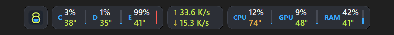
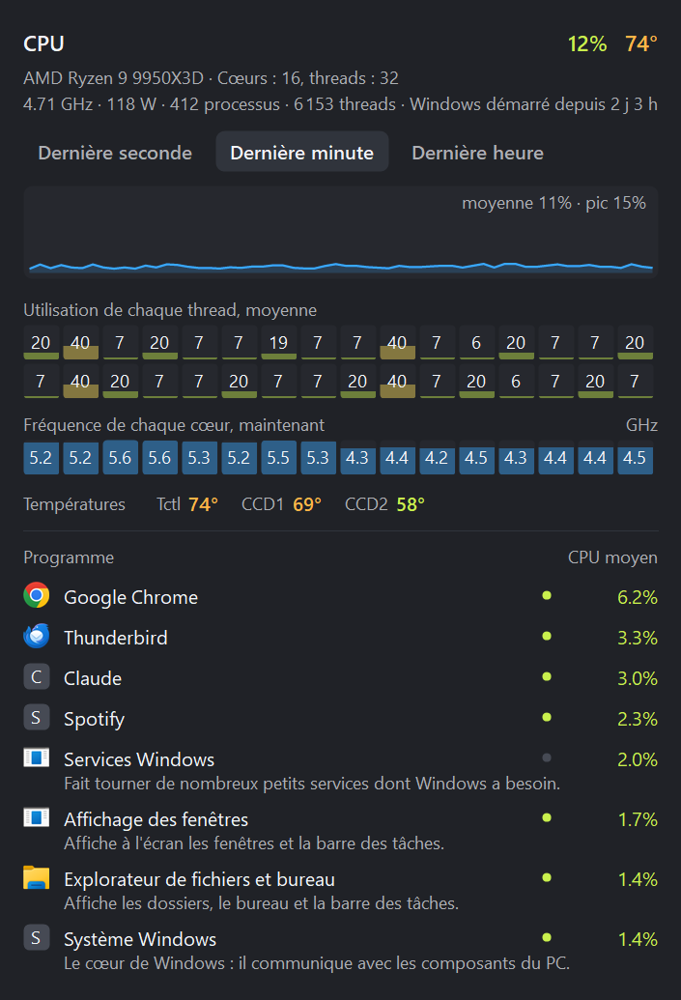
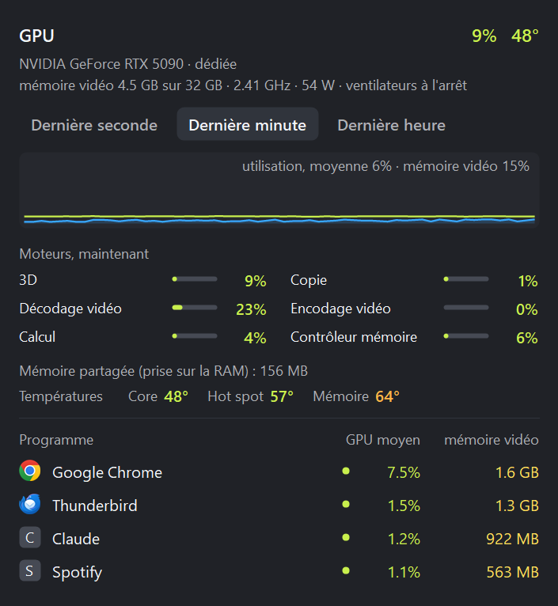
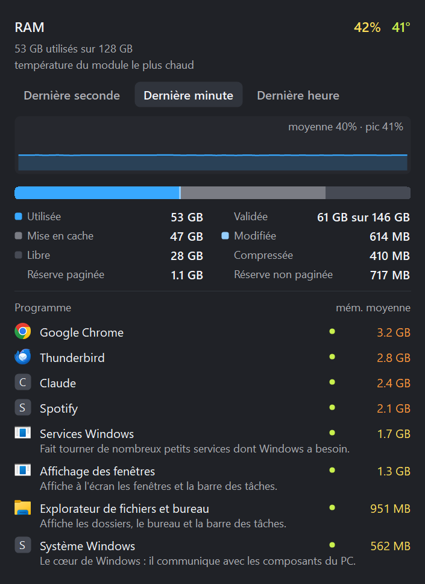
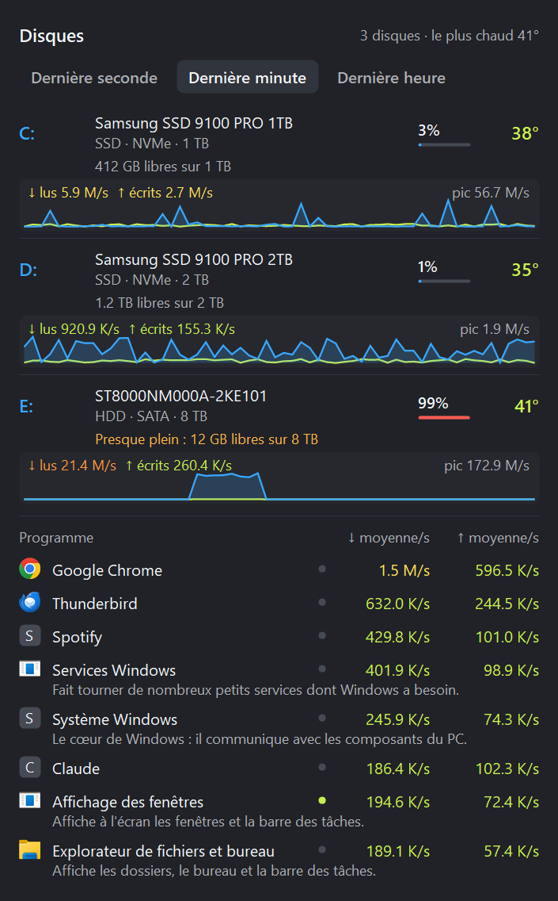
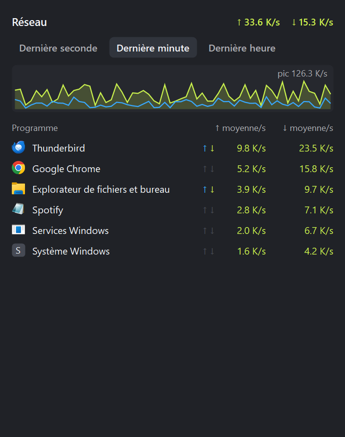
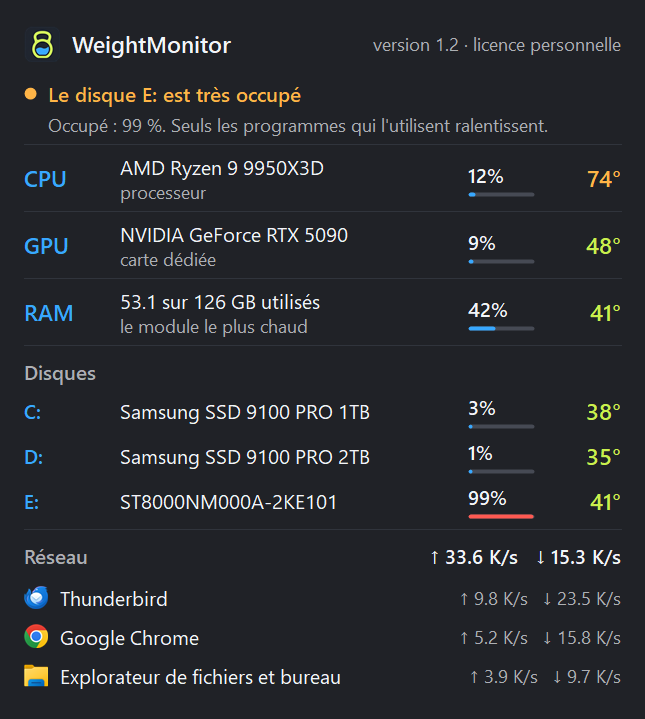
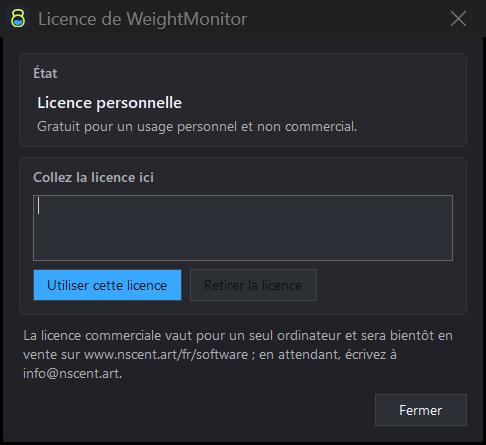

# WeightMonitor

[English](../../README.md) | [Italiano](../it/README.md) | **Français** | [Español](../es/README.md) | [Deutsch](../de/README.md)

Un tableau de bord dans la barre des tâches de Windows 11, à gauche du bouton Démarrer : disques, réseau, CPU, GPU et RAM, avec utilisation et température.
Un seul `.exe`, et toutes les sources sont ici. Il ne se met jamais à jour tout seul : il vous prévient, et vous décidez.

[Site web et licence](https://www.nscent.art/fr/software)

## Pour télécharger le programme, [cliquez ici](https://github.com/nscentart/WeightMonitor/releases/latest/download/WeightMonitor.exe)

Vous obtenez `WeightMonitor.exe` : ouvrez-le et choisissez de l'installer ou non. Le lien mène toujours à la dernière version ; les précédentes
se trouvent sur la page [Releases](https://github.com/nscentart/WeightMonitor/releases).
Au démarrage, le programme vérifie s'il existe une nouvelle version et vous le signale ; vous pouvez aussi faire un clic droit sur l'icône, puis « Vérifier les mises à jour ».



## Ce qu'il fait
- **Vous dit aussitôt comment va le PC** : en haut de la vue d'ensemble, une phrase : « Le PC va bien », ou ce qui le met en difficulté.
  Il ne parle de difficulté que si elle dure : un pic de quelques secondes ne constitue pas une alerte. Les disques comptent aussi : le disque de Windows pèse
  autant que le processeur, alors qu'un disque de données occupé est signalé sans qu'il soit dit que tout le PC peine, car il ne ralentit que les programmes qui l'utilisent.
- **Vérifie le matériel à chaque démarrage** : CPU, GPU dédié (ou intégré en l'absence de carte), modules de RAM équipés d'un
  capteur, tous les disques avec leur type (SSD/HDD), leur bus, leur capacité et leurs lettres. La liste reste en mémoire.
- **S'adapte à la place disponible** : quand la place manque, les disques se regroupent en une seule entrée, puis seul le logo reste.
  En **mode compact**, seul le logo reste, en permanence. Dans Paramètres, vous choisissez les éléments à afficher, et ce choix est conservé.
- **Cinq langues** : italien, anglais, français, espagnol et allemand. À l'installation, il propose la langue de Windows, et vous pouvez la changer dans Paramètres.
- **Lisible aussi avec une barre des tâches Windows claire** : le style Classique place un fond sombre sous les chiffres.
- **Détachée de la barre** : elle devient une fenêtre libre, que vous faites glisser où vous voulez avec le bouton gauche. Elle garde sa position, reste au-dessus
  des fenêtres normales mais sous Win+Maj+S et le menu Démarrer, et disparaît en plein écran, tout comme la barre ancrée.
- **Clic sur un élément de la barre** : un volet s'ouvre, comme celui des icônes cachées de Windows.
  - CPU : utilisation de chaque thread, fréquences, températures et programmes qui le sollicitent le plus.
  - GPU : utilisation de chaque moteur, mémoire vidéo, températures et programmes qui le sollicitent le plus.
  - RAM : utilisée, mise en cache et libre, et programmes qui en occupent le plus.
  - Disques : nom, type, température et espace libre de chacun, lectures et écritures, programmes qui lisent et écrivent.
  - Réseau : un graphique et **quel programme utilise la connexion**. Vitesse en couleur (vert, jaune, orange, rouge). Le
    volet garde toujours la même hauteur dans les trois onglets : avec beaucoup de programmes, la liste défile, à la molette ou avec
    la barre de défilement à droite, et chaque ligne conserve son bouton Fermer.
  - Logo : tout à la fois.
  - Dernière seconde, Dernière minute, Dernière heure : **chaque volet se souvient de son onglet**, même après un redémarrage. Le volet
    ne recouvre jamais la barre détachée : il s'ouvre au-dessus ou en dessous et, faute de place, il raccourcit ou se décale sur le côté. S'il est plus haut que
    l'écran, il défile, à la molette ou avec les touches fléchées : les programmes du bas ne se perdent pas.
  - Les programmes courants de Windows ont un nom clair et une ligne qui explique leur rôle, par exemple « Services Windows ».
- **Bouton Fermer sur la ligne d'un programme** : il demande toujours confirmation, en donnant le nom du programme et en prévenant que le travail non
  enregistré peut être perdu. La fermeture se fait en douceur, comme avec le X de la fenêtre : si le programme a quelque chose à enregistrer, il vous le demande en général
  lui-même, et s'il ne se ferme pas, WeightMonitor le signale et s'en tient là, sans jamais le forcer. Le bouton n'apparaît ni sur
  les programmes de Windows, ni sur les processus système, ni sur ceux d'autres utilisateurs, ni sur WeightMonitor lui-même, ni sur les programmes sans fenêtre
  ouverte. Juste avant de fermer, il vérifie de nouveau qu'il s'agit bien du même programme.
- **Notifications** : un message court quand le PC peine, en termes simples, avec le responsable et ce que vous pouvez faire. Par
  exemple : *Le programme « Chrome » utilise 62 % du processeur. Le PC pourrait ralentir. Si vous n'en avez pas besoin, fermez-le.* Le programme
  ne ferme jamais rien de lui-même. Il prévient aussi quand le processeur ou la carte graphique restent très chauds (97 et 90 degrés pendant une
  minute : des seuils volontairement élevés, car chaque processeur a ses propres limites) et quand un disque est presque plein. Aucun son, et silence pendant les jeux, en plein écran, quand la barre des tâches est masquée et en mode Ne pas
  déranger. Une même cause ne revient pas plus d'une fois toutes les 30 minutes. Cliquer sur la notification ouvre le volet de l'élément concerné ; si
  la notification porte sur un programme qui peut être fermé, le clic ouvre la même confirmation que le bouton Fermer, où vous pouvez
  le fermer, voir les détails ou annuler. Vous pouvez
  désactiver les notifications depuis le menu, « Notifications », ou dans Paramètres.
- **Clic droit** sur la barre ou sur l'icône parmi les icônes cachées : un menu court avec Paramètres..., Apparence (Mode
  compact, Détachée de la barre), Notifications, **Envoyer le journal des erreurs**, Vérifier les mises à jour et Fermer.
- **Licence personnelle ou commerciale** : la mention figure en haut de la vue d'ensemble et en bas des Paramètres ; un clic sur celle des Paramètres ouvre la fenêtre où coller la licence. Ce n'est qu'une mention : toutes les fonctions restent identiques et le contrôle se fait dans le programme, sans réseau.
- **Fenêtre Paramètres** (depuis le menu, ou double-clic sur l'icône) : Langue, Couleur, Sombre ou clair, Mode compact, Détachée de la barre, Style, Afficher dans la barre, Notifications, Vérifier au démarrage s'il y a une nouvelle version, Revérifier le matériel, Ouvrir le dossier des données. Avec Appliquer ou OK, la barre change aussitôt. Si vous
  la retirez de la barre des tâches, le programme reste actif parmi les icônes cachées, et un message le signale.
- **Cinq couleurs, chacune en sombre ou en clair**, pour la barre, les volets et les fenêtres : Bleu (la principale), Vert, Citron, Rose et Violet, avec Automatique qui suit Windows sans redémarrage. Vous les choisissez
  dans Paramètres, elles s'appliquent avec Appliquer ou OK et sont conservées après les mises à jour. Le rouge et l'orange signalent uniquement la chaleur et l'effort, quel que soit le thème.
- Il disparaît de lui-même pendant les jeux et les vidéos en plein écran.

| CPU | GPU | RAM |
|---|---|---|
|  |  |  |

| Disques | Réseau | Tout |
|---|---|---|
|  |  |  |

## Installer
1. Téléchargez `WeightMonitor.exe` avec le lien ci-dessus, dans un nouveau dossier vide : quand un programme démarre en tant qu'administrateur, Windows
   peut charger les fichiers qu'il trouve à côté de lui.
2. Ouvrez-le : vous choisissez **Installer** ou **Utiliser sans installer**.
3. **Installer** demande une seule fois l'autorisation d'administrateur, copie l'exe dans `C:\Program Files\WeightMonitor` et le lance
   à chaque ouverture de session Windows.
4. Si **PawnIO** n'est pas déjà présent, une fenêtre explique avant l'installation de quoi il s'agit, et vous choisissez avec deux boutons, aucun des deux
   présélectionné : « Oui, l'installer : je verrai les températures » ou « Non : pas de températures de CPU, RAM et disques ». PawnIO est un pilote
   de niveau système : il reste installé même quand vous retirez WeightMonitor, et certains systèmes anti-triche de jeux peuvent ne pas l'apprécier.

Vous le retirez depuis « Paramètres > Applications installées ».

Windows peut vous avertir au premier lancement : [plus bas](#pourquoi-windows-ou-votre-antivirus-peuvent-vous-avertir), vous verrez ce que cela signifie et
comment vérifier le fichier.

### L'utiliser sans l'installer
**Utiliser sans installer** démarre depuis l'emplacement du fichier et ne demande aucune autorisation. Les températures restent à « -- » et on ne voit pas quel
programme utilise le réseau et les disques : pour les voir, il faut l'installer. Si vous lancez manuellement en tant qu'administrateur une copie non installée, elle fonctionne
quand même, mais c'est un risque : ses paramètres et son journal restent dans le dossier de l'utilisateur, où n'importe quel programme peut
écrire, et Windows peut charger les fichiers qu'il trouve à côté de l'exe. Si vous voulez ces droits, mieux vaut l'installer.

## Pourquoi Windows ou votre antivirus peuvent vous avertir
**L'exe n'a pas de certificat Windows** : un certificat se paie chaque année et indique qui a fait le programme, mais
pas que celui-ci est sûr. Sans certificat, Windows ne sait pas qui en est l'auteur et vous avertit au début.

**Ce que vous pouvez voir**
- La fenêtre bleue « Windows a protégé votre ordinateur ». Elle signifie « je ne connais pas ce fichier », et non « j'ai trouvé un virus ». Pour
  continuer : **Informations complémentaires**, puis **Exécuter quand même**. L'avertissement peut revenir à chaque nouvelle version.
- « Éditeur inconnu » quand Windows demande l'autorisation d'administrateur.
- Si le Contrôle intelligent des applications de Windows 11 est activé, le programme est bloqué, sans aucun choix. Nous ne conseillons pas de le désactiver uniquement
  pour WeightMonitor : si vous le gardez activé, ce programme n'est pas pour vous.

**Pourquoi certains antivirus peuvent se méfier.** Nous ne pouvons pas promettre qu'aucun ne le fera. Pour faire son travail,
WeightMonitor demande les droits d'administrateur, démarre à l'ouverture de session au moyen d'une tâche planifiée, observe qui utilise le réseau et les disques et, si
vous le demandez, télécharge et installe le pilote PawnIO. Ce sont des choses normales pour un moniteur système, mais elles ressemblent aussi à ce que font
les programmes malveillants.

**Si votre antivirus le signale**, inutile de le désactiver. Vérifiez l'empreinte comme expliqué ci-dessous et
[ouvrez un signalement](https://github.com/nscentart/WeightMonitor/issues) en indiquant le nom de l'antivirus et le texte de
l'avertissement. Si vous n'avez pas confiance, ne l'installez pas : c'est le bon choix.

**Comment vérifier le fichier**
1. Téléchargez-le uniquement depuis cette page : c'est le seul WeightMonitor officiel.
2. Ouvrez PowerShell dans le dossier du fichier et tapez : `Get-FileHash .\WeightMonitor.exe -Algorithm SHA256`
3. Le résultat doit être identique à l'empreinte SHA-256 indiquée dans la version publiée.

S'il est identique, vous avez bien le fichier que nous avons publié. Cela ne prouve pas qu'il soit exempt de défauts : pour cela, il y a le code,
que vous pouvez lire ici.

## Mettre à jour
WeightMonitor ne télécharge et n'installe jamais rien tout seul. Il se contente de vérifier : s'il existe une nouvelle version, il vous le signale et, quand vous
cliquez sur « Ouvrir la page de la version », il ouvre sa page GitHub dans le navigateur, où vous voyez ce qui a changé et la comparaison
avec le code précédent. Pour mettre à jour :
1. Depuis cette page, téléchargez `WeightMonitor.exe`, dans un nouveau dossier vide.
2. Ouvrez-le et choisissez **Installer** : il ferme l'ancienne version, prend sa place et redémarre. Vos choix sont conservés.

La fenêtre de l'avis affiche aussi l'empreinte SHA-256 du nouvel exe, sur une ligne fixe au-dessus des notes : sélectionnez-la et comparez-la avec celle du fichier que vous téléchargez, comme expliqué dans « Comment vérifier le fichier ». Si GitHub et les notes ne concordent pas, la fenêtre avertit en rouge de ne pas utiliser ce fichier ; si l'empreinte n'est pas indiquée, elle le dit et renvoie à la page de la version. Le programme ne fait qu'afficher l'empreinte : il ne télécharge et ne compare rien tout seul.

Si vous utilisez la copie sans installation, il suffit d'utiliser le nouvel exe à la place de l'ancien. Vous pouvez désactiver la vérification dans Paramètres ;
même dans ce cas, la dernière version reste accessible par le lien en haut de cette page.

## Configuration requise
- Windows 10 ou 11, 64 bits (x64). .NET Framework 4.7.2 ou ultérieur, déjà inclus dans Windows.
- Les températures nécessitent les droits d'administrateur et le pilote PawnIO, comme pour tout programme de ce type.

## Ce à quoi il touche, en toute transparence
- **Internet** : une seule question à GitHub au démarrage, « existe-t-il une version plus récente ? » (vous pouvez la désactiver dans Paramètres). La
  réponse sert uniquement à vous prévenir : le navigateur n'ouvre jamais qu'une page du dépôt officiel, quoi que dise la
  réponse, et le programme ne télécharge aucune mise à jour. S'y ajoute le téléchargement de PawnIO pendant l'installation, si vous
  le choisissez. Avant de le lancer, le programme vérifie que la signature numérique est valide et appartient à namazso, l'auteur de PawnIO.
- **Réseau par programme** : il lit dans le journal d'événements du noyau Windows (ETW, `Microsoft-Windows-Kernel-Network`)
  uniquement le programme et les octets de chaque paquet. Jamais le contenu, jamais les adresses. L'historique reste en mémoire et
  disparaît à la fermeture.
- **Notifications** : elles utilisent les chiffres dont le programme dispose déjà, ne sortent pas du PC, et le journal note seulement qu'un
  message a été émis, sans le nom du programme.
- **Fichiers** : dans `C:\Program Files\WeightMonitor\data` s'il est installé, dans
  `%LOCALAPPDATA%\WeightMonitor` s'il est portable ou sans droits. On n'y trouve que `settings.ini` (les choix faits dans le programme), `license.txt` (la licence commerciale, si vous l'avez collée) et `WeightMonitor.log`
  (erreurs, plantages, notifications envoyées et raisons pour lesquelles il s'est masqué de la barre ; 256 Ko au maximum). Tout le reste se trouve en mémoire et
  disparaît à la fermeture. Les fichiers écrits par les versions 1.0 et 1.1 (`dati`, `impostazioni.ini`, `licenza.txt`) sont lus une seule fois, quand les nouveaux manquent, et le programme ne les modifie ni ne les supprime tant qu'il fonctionne.
- **Journal des erreurs** : « Envoyer le journal des erreurs » affiche le rapport complet, dont le nom d'utilisateur, le nom de l'ordinateur et les chemins de fichiers
  ont déjà été retirés (les modèles de matériel restent), et ouvre dans le navigateur un signalement prérempli dans ce dépôt. C'est vous qui l'envoyez,
  avec votre compte, et **le signalement est public** : le programme n'envoie rien de lui-même.
- **Système** : une tâche planifiée « WeightMonitor » à l'ouverture de session, l'entrée dans « Applications installées » et le raccourci du menu Démarrer
  pour tous les utilisateurs (si le programme est déjà lancé, il ouvre Paramètres, sans seconde copie). Rien d'autre.

## Compiler à partir des sources
Vous pouvez le compiler à partir de ces sources pour un usage personnel. Il suffit de Windows : le compilateur C# de .NET Framework 4 est déjà dans le système.
```powershell
powershell -NoProfile -ExecutionPolicy Bypass -File scripts/libraries.ps1   # LibreHardwareMonitor 0.9.6, empreinte vérifiée
powershell -NoProfile -ExecutionPolicy Bypass -File scripts/build.ps1    # bin\WeightMonitor.exe
```
L'empreinte sera différente de celle de la version publiée, et c'est normal : le compilateur écrit dans le fichier la date et un nouveau code à
chaque compilation.

Une option qui n'existe pas, ou à laquelle il manque sa valeur, ne lance rien : le programme se termine avec le code 2 et, si
`--result file` est présent, y écrit la raison.

Tests sans installation : `WeightMonitor.exe --screenshot test.png --sample [--view extended|collected|compact]
[--flyout cpu|gpu|ram|disks|network|all] [--tab 0|1|2]`, `--screenshot-settings test.png [--scale 1.5]`, `--screenshot-menu test.png`, `--screenshot-welcome test.png [--without-pawnio]`, `--screenshot-pawnio test.png`,
`--screenshot-update test.png`, avec `--flyout` également `--screen-height 400 --scroll 200` (un volet plus haut que l'écran) et `--programs 40` (nombre de programmes dans le volet Réseau),
`--language it|en|fr|es|de --color blue|green|lemon|pink|purple --appearance auto|dark|light` (avec n'importe quelle image : elles ne valent que pour cette fois et ne sont pas enregistrées), `--close-button` (le bouton Fermer sur les programmes d'exemple, dans les images d'exemple), `--test-themes [--result file]` (chaque thème est complet, lisible et mémorisé ; une valeur absurde ne casse rien),
`--test-notifications [--result file]` (données fictives : écrit quelles notifications se déclencheraient et leur texte, sans les afficher), `--test-flyouts [--result file]` (où s'ouvrent les volets et comment ils défilent), `--test-disks [--result file]` (un changement fictif sur les vrais compteurs des disques), `--test-etw [--result file]` (la lecture par programme, réellement interrompue sur une session séparée : nécessite les droits d'administrateur), `--test-close [--result file]` (le bouton Fermer sur une liste fictive de programmes : ceux qui restent exclus et le numéro de processus réutilisé. Ne ferme rien), `--test-languages [--result file]` (les textes des cinq langues), `--test-license [--result file]` (la licence avec une clé de test créée en mémoire, et les mentions dans les cinq langues), `--screenshot-license test.png [--holder nom] [--message other|revoked|invalid|unreadable|active|removed]` (la fenêtre de la licence ; avec chaque photo, `--holder` montre une licence commerciale d'exemple, et le vrai fichier de licence n'apparaît jamais), `--screenshot-confirm test.png [--windows 3] [--details]`, avec `--flyout` également `--close-button`, avec `--screenshot` également `--background light`, `--sentence yes`, `--show cpu,ram`, `--test-security [--result file] [--signature file]` (déplacement des paramètres, adresses, vérification des mises à jour, choix de PawnIO, reprise de la lecture, nettoyage du rapport, options de la ligne de commande), `--test-migration --data dossier [--result file]` (les paramètres, la licence et le journal écrits par les versions 1.0 et 1.1, lus à partir des fichiers d'exemple de `tests/legacy-data`), `--test-capture` (pendant une capture, note dans le journal ce qui se trouve sur
les points de la barre, si l'info-bulle s'affiche et quel est le curseur), ou `--preview` (flottant
au-dessus de la barre).

## Le code
Les fichiers sources, les noms de fichiers et les noms d'options sont en anglais ; l'interface et la documentation existent en cinq langues.
- `src/Sensors.cs` : l'inventaire et la lecture des capteurs, sur son propre thread.
- `src/Network.cs` : qui utilise le réseau, via ETW.
- `src/Details.cs` : les chiffres des volets et leurs historiques.
- `src/Drawing.cs`, `src/Drawing.Flyouts.cs`, `src/Flyout.cs` : la barre et les volets.
- `src/Notifications.cs`, `src/Health.cs`, `src/Sentence.cs` : les messages quand le PC peine et la phrase en haut de la vue d'ensemble.
- `src/Explanations.cs` : nom clair et ligne en termes simples pour les programmes courants de Windows.
- `src/ProgramCloser.cs` : le bouton Fermer, avec ses exclusions et la confirmation.
- `src/License.cs`, `src/LicenseWindow.cs` : le contrôle du texte de la licence et sa fenêtre. De simples mentions : aucune fonction n'en dépend.
- `src/Program.cs` : le démarrage, l'icône, la barre ancrée à la barre des tâches de Windows, les volets.
- `src/SettingsWindow.cs` : la fenêtre Paramètres.
- `src/Language.cs` et `locales/` : les cinq langues. `src/Theme.cs` : les couleurs.
- `src/Installer.cs` : installation, PawnIO, désinstallation.
- `src/ErrorReport.cs` : le rapport d'erreurs.
- `src/UpdateChecker.cs` : vérifie s'il existe une nouvelle version et ouvre sa page.
- `src/Tests/` : les tests, lancés par `scripts/test.ps1`. `tests/legacy-data/` : fichiers d'exemple des versions 1.0 et 1.1 pour le test de migration.
- `scripts/` : `build.ps1`, `libraries.ps1`, `test.ps1`, `update.ps1` et `screenshots.ps1`, qui régénère les images de `docs/` à partir de la compilation.

Les versions se trouvent dans [CHANGELOG.md](../../CHANGELOG.md) ; les composants tiers dans [THIRD-PARTY-NOTICES.md](../THIRD-PARTY-NOTICES.md).

## Licence
[PolyForm Strict 1.0.0](../../LICENSE.md) : WeightMonitor est gratuit pour un usage personnel et non commercial,
et le code peut être lu. Il ne peut être ni modifié, ni redistribué, ni republié, pas même sous forme de copie ou de « fork » sur
un autre site. Le seul WeightMonitor officiel est celui qui se télécharge depuis cette page. L'usage commercial est payant, en une seule
fois, avec une licence par ordinateur, numérotée (NomEntreprise_01, NomEntreprise_02...) : la licence commerciale sera bientôt en vente sur [nscent.art](https://www.nscent.art/fr/software) ; en attendant, écrivez à info@nscent.art. Les composants tiers restent sous leur propre licence : [THIRD-PARTY-NOTICES.md](../THIRD-PARTY-NOTICES.md).

La fenêtre de la licence :


