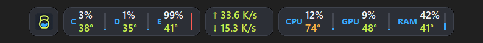
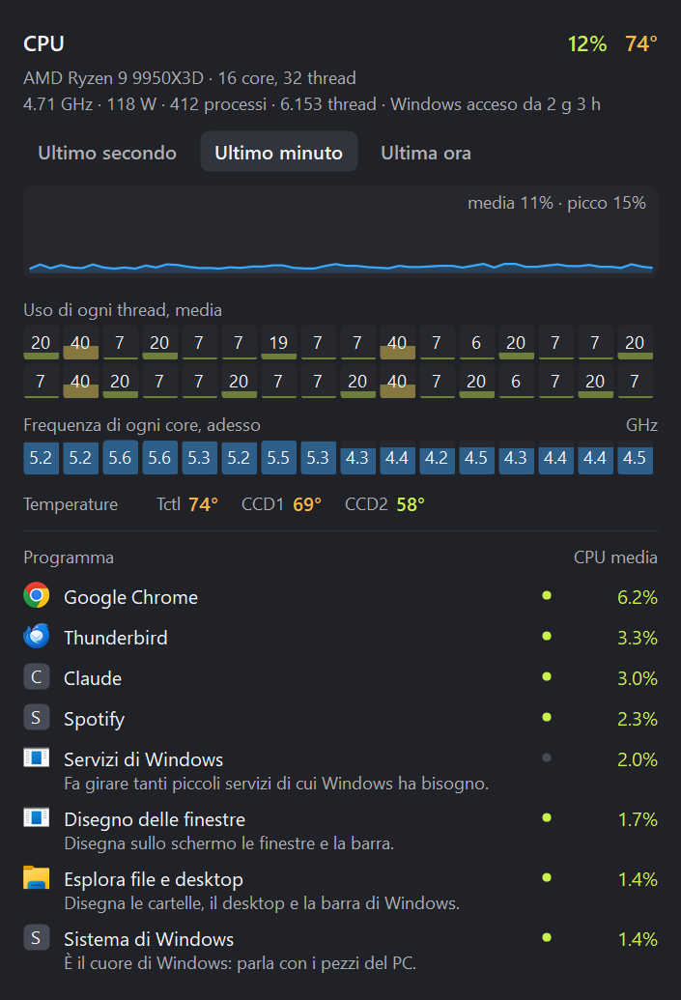
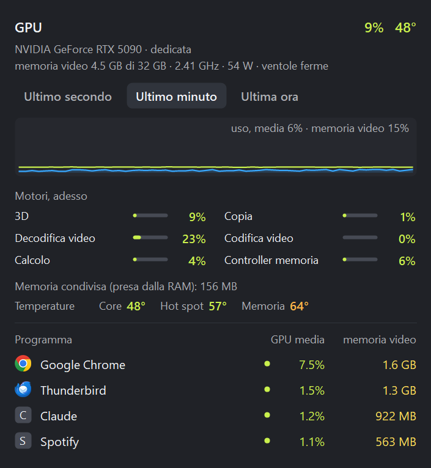
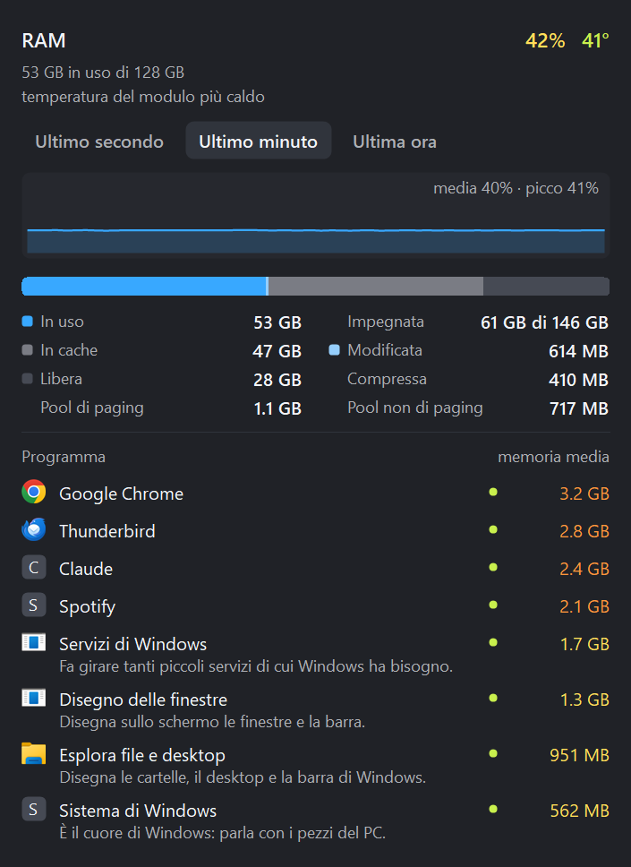
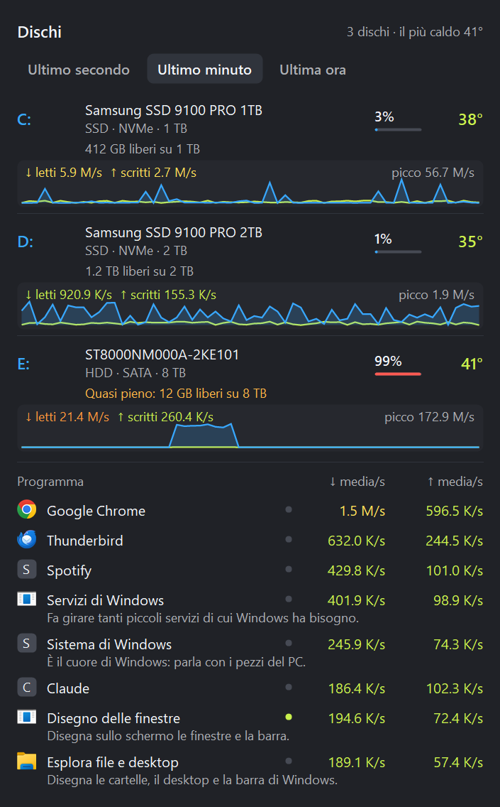
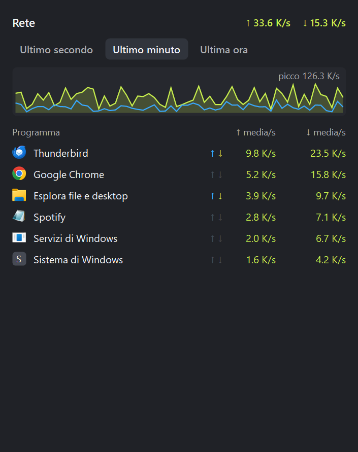
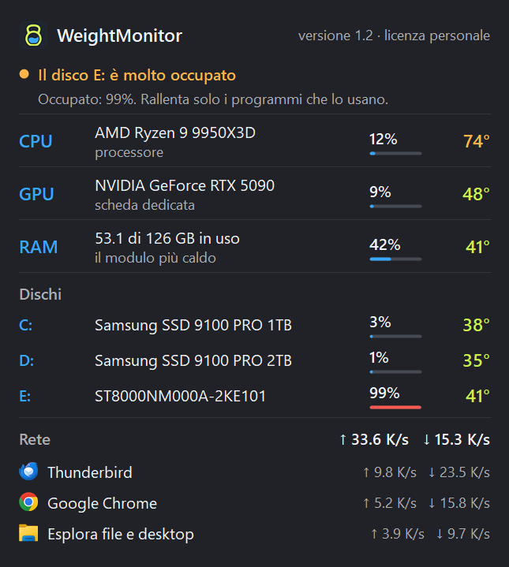
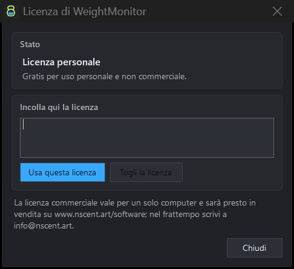

# WeightMonitor

[English](../../README.md) | **Italiano** | [Français](../fr/README.md) | [Español](../es/README.md) | [Deutsch](../de/README.md)

Un cruscotto nella barra di Windows 11, a sinistra del tasto Start: dischi, rete, CPU, GPU e RAM, con uso e temperatura.
Un solo `.exe`, con tutto il sorgente qui. Non si aggiorna mai da solo: ti avvisa, e decidi tu.

[Sito e licenza](https://www.nscent.art/software)

## Per scaricare il programma, [clicca qui](https://github.com/nscentart/WeightMonitor/releases/latest/download/WeightMonitor.exe)

Scarichi `WeightMonitor.exe`: lo apri e scegli se installarlo. Il link porta sempre all'ultima versione; le precedenti
stanno nella pagina [Releases](https://github.com/nscentart/WeightMonitor/releases).
Il programma all'avvio controlla se c'è una versione nuova e te lo dice; oppure clic destro sull'icona, «Controlla aggiornamenti».



## Cosa fa
- **Dice subito come sta il PC**: in cima alla panoramica una frase, «Il PC sta bene» oppure chi lo sta facendo faticare.
  Dice che fatica solo se dura: un picco di pochi secondi non è un allarme. Conta anche i dischi: il disco di Windows pesa
  quanto il processore, mentre un disco dati occupato si segnala senza dire che tutto il PC fatica, perché rallenta solo chi lo usa.
- **Controlla l'hardware a ogni avvio**: CPU, GPU dedicata (o quella integrata se non c'è una scheda), moduli RAM col
  sensore, tutti i dischi con SSD/HDD, bus, taglia e lettere. L'elenco resta in memoria.
- **Si adatta allo spazio**: se manca posto, i dischi si raccolgono da soli in una voce sola, poi resta solo il logo.
  Con la **modalità compatta** resta sempre solo il logo. Nelle Impostazioni scegli quali pezzi mostrare, e la scelta resta.
- **Cinque lingue**: italiano, inglese, francese, spagnolo e tedesco. All'installazione propone quella di Windows, e si cambia dalle Impostazioni.
- **Si legge anche con la barra di Windows chiara**: lo stile Classico mette una lastra scura sotto i numeri.
- **Sganciata dalla barra**: diventa una finestra libera che trascini col tasto sinistro dove vuoi. Ricorda il posto, sta sopra
  le finestre normali ma sotto Win+Maiusc+S e il menu Start, e sparisce a tutto schermo come quella agganciata.
- **Clic su un pezzo della barra**: si apre una tendina, come le icone nascoste di Windows.
  - CPU: uso di ogni thread, frequenze, temperature e i programmi che la usano di più.
  - GPU: uso di ogni motore, memoria video, temperature e i programmi che la usano di più.
  - RAM: in uso, in cache e libera, e i programmi che ne tengono di più.
  - Dischi: nome, tipo, temperatura e spazio libero di ognuno, letture e scritture, i programmi che leggono e scrivono.
  - Rete: grafico e **quale programma usa la connessione**. Velocità a colori (verde, giallo, arancione, rosso). La
    tendina ha sempre la stessa altezza in tutte e tre le schede: con tanti programmi l'elenco scorre, con la rotella o con
    la barra a destra, e ogni riga conserva il suo tasto Chiudi.
  - Logo: tutto insieme.
  - Ultimo secondo, ultimo minuto, ultima ora: **ogni tendina ricorda la sua scheda**, anche dopo il riavvio. La tendina
    non copre mai la barra sganciata: si apre sopra o sotto, e se manca posto si accorcia o va di lato. Se è più alta dello
    schermo scorre con la rotella o coi tasti freccia: i programmi in fondo non si perdono.
  - I programmi comuni di Windows hanno un nome chiaro e una riga che spiega cosa fanno, per esempio «Servizi di Windows».
- **Tasto Chiudi sulla riga di un programma**: chiede sempre conferma, col nome del programma e l'avviso che il lavoro non
  salvato può andare perso. Chiude con garbo, come la X della finestra: se il programma ha qualcosa da salvare di solito te
  lo chiede lui, e se non si chiude, WeightMonitor lo dice e basta: non lo chiude mai a forza. Il tasto non compare sui
  programmi di Windows, sui processi di sistema, su quelli di altri utenti, su WeightMonitor stesso e sui programmi senza una
  finestra aperta. Subito prima di chiudere ricontrolla che sia ancora lo stesso programma.
- **Notifiche**: un avviso breve quando il PC fatica, in parole semplici, con chi è il colpevole e cosa puoi fare. Per
  esempio: «Chrome sta usando il 62% del processore. Il PC potrebbe rallentare. Se non ti serve, chiudilo.» Il programma
  non chiude mai niente da solo. Avvisa anche quando processore o scheda video restano molto caldi (97 e 90 gradi per un
  minuto: soglie alte apposta, perché ogni processore ha limiti suoi) e quando un disco è quasi pieno. Niente suoni, e silenzio coi giochi, a tutto schermo, con la barra nascosta e con Non disturbare.
  La stessa causa torna al massimo ogni 30 minuti. Il clic sulla notifica apre la tendina di quel pezzo; se
  la notifica parla di un programma che si può chiudere, il clic apre invece la stessa conferma del tasto Chiudi, dove puoi
  chiuderlo, guardare i dettagli o annullare. Le notifiche si spengono dal menu, voce «Notifiche», o dalle Impostazioni.
- **Clic destro** sulla barra o sull'icona fra le icone nascoste: un menu corto con Impostazioni..., Aspetto (modalità
  compatta, sganciata dalla barra), Notifiche, **Invia log degli errori**, Controlla aggiornamenti e Chiudi.
- **Licenza personale o commerciale**: la scritta è in cima alla panoramica e in fondo alle Impostazioni; un clic su quella delle Impostazioni apre la finestra dove incollare la licenza. È solo una scritta: tutte le funzioni restano uguali, e il controllo avviene dentro il programma, senza rete.
- **Finestra Impostazioni** (dal menu, o doppio clic sull'icona): lingua, colore, scuro o chiaro, modalità compatta, sganciata dalla barra, stile, mostra nella barra, notifiche, controllo degli aggiornamenti
  all'avvio, rifai il controllo dell'hardware, apri la cartella dei dati. Con Applica o OK la barra cambia subito. Se lo
  togli dalla barra resta acceso fra le icone nascoste, e un avviso lo dice.
- **Cinque colori, ognuno scuro o chiaro**, per barra, tendine e finestre: Blu (il principale), Verde, Limone, Rosa e Viola, con Automatico che segue Windows senza riavviare. Si scelgono
  nelle Impostazioni, valgono con Applica o OK e restano dopo gli aggiornamenti. Rosso e arancione vogliono dire solo caldo e fatica, in tutti i temi.
- Sparisce da solo coi giochi e i video a tutto schermo.

| CPU | GPU | RAM |
|---|---|---|
|  |  |  |

| Dischi | Rete | Tutto |
|---|---|---|
|  |  |  |

## Installare
1. Scarica `WeightMonitor.exe` col link qui sopra, in una cartella nuova e vuota: Windows, quando un programma parte da
   amministratore, può caricare i file che trova accanto a lui.
2. Aprilo: scegli tu **Installa** oppure **Usa senza installare**.
3. Installa chiede una volta il permesso di amministratore, copia l'exe in `C:\Program Files\WeightMonitor` e lo fa
   partire a ogni accesso a Windows.
4. Se **PawnIO** non c'è già, prima dell'installazione una finestra spiega cos'è e tu scegli con due tasti, nessuno dei due già
   scelto: «Sì, installalo: vedrò le temperature» oppure «No: niente temperature di CPU, RAM e dischi». PawnIO è un driver
   a livello di sistema: resta installato anche quando togli WeightMonitor, e alcuni anti-cheat dei giochi possono non gradirlo.

Si toglie da «Impostazioni > App installate».

Windows può avvisare al primo avvio: vedi [qui sotto](#perché-windows-o-lantivirus-possono-avvisarti) cosa significa e
come controllare il file.

### Usarlo senza installare
**Usa senza installare** parte da dove si trova e non chiede permessi. Le temperature restano «--» e non si vede quale
programma usa rete e dischi: per vederli si installa. Se avvii a mano da amministratore una copia non installata, funziona lo
stesso, ma è un rischio: le sue impostazioni e il suo log restano nella cartella dell'utente, dove può scrivere
qualunque programma, e Windows può caricare i file che trova accanto all'exe. Se vuoi quei permessi, meglio installare.

## Perché Windows o l'antivirus possono avvisarti
**L'exe non ha un certificato di Windows**: il certificato si paga ogni anno e serve a dire chi ha fatto il programma, non
che il programma è sicuro. Senza certificato, Windows non sa chi sia l'autore e all'inizio avvisa.

**Cosa puoi vedere**
- La finestra blu «Windows ha protetto il PC». Significa «non conosco questo file», non «ho trovato un virus». Per
  proseguire: **Ulteriori informazioni**, poi **Esegui comunque**. Con ogni versione nuova l'avviso può tornare.
- «Editore sconosciuto» quando Windows chiede il permesso di amministratore.
- Con Smart App Control di Windows 11 attivo, il programma viene bloccato senza scelta. Non consigliamo di spegnerlo solo
  per WeightMonitor: se lo tieni acceso, questo programma non fa per te.

**Perché qualche antivirus potrebbe insospettirsi.** Non possiamo promettere che nessuno lo farà. Per fare il suo lavoro
WeightMonitor chiede i permessi di amministratore, parte all'accesso con un'attività pianificata, legge chi usa rete e dischi e, se
glielo chiedi, scarica e installa il driver PawnIO. Sono cose normali per un monitor di sistema, ma somigliano a quello
che fanno anche i programmi cattivi.

**Se il tuo antivirus lo segnala**, non serve disattivarlo. Controlla l'impronta come spiegato qui sotto e
[apri una segnalazione](https://github.com/nscentart/WeightMonitor/issues) col nome dell'antivirus e il testo
dell'avviso. Se non ti fidi, non installarlo: è la scelta giusta.

**Come verificare il file**
1. Scaricalo solo da questa pagina: è l'unico WeightMonitor ufficiale.
2. Apri PowerShell nella cartella del file e scrivi: `Get-FileHash .\WeightMonitor.exe -Algorithm SHA256`
3. Il risultato deve essere identico all'impronta SHA-256 scritta nella release.

Se è identica, hai il file che abbiamo pubblicato. Questo non prova che sia privo di difetti: per quello c'è il codice,
che puoi leggere qui.

## Aggiornare
WeightMonitor non scarica e non installa mai niente da solo. Controlla soltanto: se c'è una versione nuova te lo dice e, col
clic su «Apri la pagina della versione», apre nel browser la sua pagina su GitHub, dove vedi cosa è cambiato e il confronto
col codice di prima. Per aggiornare:
1. Da quella pagina scarica `WeightMonitor.exe`, in una cartella nuova e vuota.
2. Aprilo e scegli **Installa**: chiude la versione vecchia, prende il suo posto e riparte. Le tue scelte restano.

La finestra dell'avviso mostra anche l'impronta SHA-256 dell'exe nuovo, su una riga fissa sopra le note: selezionala e confrontala con quella del file che scarichi, come spiegato in «Come verificare il file». Se GitHub e le note non concordano, la finestra avverte in rosso di non usare quel file; se l'impronta non è indicata, lo dice e rimanda alla pagina della versione. Il programma mostra soltanto l'impronta: non scarica e non confronta niente da solo.

Se usi la copia senza installazione, basta usare l'exe nuovo al posto del vecchio. Il controllo si spegne dalle Impostazioni;
anche spento, l'ultima versione è sempre al link in cima a questa pagina.

## Requisiti
- Windows 10 o 11 a 64 bit (x64). .NET Framework 4.7.2 o successivo, già dentro Windows.
- Le temperature vogliono i permessi di amministratore e il driver PawnIO, come ogni programma di questo tipo.

## Cosa tocca, per trasparenza
- **Internet**: una sola domanda all'avvio a GitHub, «c'è una versione più nuova?» (si spegne dalle Impostazioni). La
  risposta serve solo ad avvisarti: nel browser si apre solo una pagina della repo ufficiale, qualunque cosa dica la
  risposta, e il programma non scarica nessun aggiornamento. Poi lo scaricamento di PawnIO durante l'installazione, se lo
  scegli. Prima di avviarlo, il programma controlla che la firma digitale sia valida e appartenga a namazso, l'autore di PawnIO.
- **Rete per programma**: legge dal registro eventi del kernel di Windows (ETW, `Microsoft-Windows-Kernel-Network`)
  solo il programma e i byte di ogni pacchetto. Mai il contenuto, mai gli indirizzi. La storia sta in memoria e
  sparisce alla chiusura.
- **Notifiche**: usano i numeri che il programma ha già, non escono dal PC, e nel log resta solo che è partito un
  avviso, senza il nome del programma.
- **File**: da installato in `C:\Program Files\WeightMonitor\data`, da portatile o senza permessi in
  `%LOCALAPPDATA%\WeightMonitor`. Ci sono solo `settings.ini` (le scelte fatte nel programma), `license.txt` (la licenza commerciale, se l'hai incollata) e `WeightMonitor.log`
  (errori, crash, le notifiche partite e i motivi per cui si è nascosto dalla barra; al massimo 256 KB). Tutto il resto vive in memoria e
  sparisce alla chiusura. I file scritti dalle versioni 1.0 e 1.1 (`dati`, `impostazioni.ini`, `licenza.txt`) vengono letti una volta sola, quando mancano quelli nuovi, e il programma non li modifica né li cancella finché è in funzione.
- **Log degli errori**: «Invia log degli errori» mostra il rapporto intero, con nome utente, nome del computer e percorsi dei file
  già tolti (restano i modelli dell'hardware), e apre nel browser una segnalazione già compilata in questa repo. La mandi
  tu, col tuo account, e **la segnalazione è pubblica**: il programma da solo non manda niente.
- **Sistema**: un'attività pianificata «WeightMonitor» all'accesso, la voce in «App installate» e il collegamento
  nel menu Start per tutti gli utenti (a programma acceso apre le Impostazioni, senza una seconda copia). Nient'altro.

## Compilare da zero
Puoi compilarlo da questo sorgente per uso personale. Serve solo Windows: il compilatore C# del .NET Framework 4 è già nel sistema.
```powershell
powershell -NoProfile -ExecutionPolicy Bypass -File scripts/libraries.ps1   # LibreHardwareMonitor 0.9.6, impronta verificata
powershell -NoProfile -ExecutionPolicy Bypass -File scripts/build.ps1    # bin\WeightMonitor.exe
```
L'impronta sarà diversa da quella della release, ed è normale: il compilatore scrive nel file la data e un codice nuovo a
ogni compilazione.

Un'opzione che non esiste, o che manca del suo valore, non fa partire niente: il programma esce con esito 2 e, se c'è
`--result file`, scrive lì il motivo.

Prove senza installare: `WeightMonitor.exe --screenshot test.png --sample [--view extended|collected|compact]
[--flyout cpu|gpu|ram|disks|network|all] [--tab 0|1|2]`, `--screenshot-settings test.png [--scale 1.5]`, `--screenshot-menu test.png`, `--screenshot-welcome test.png [--without-pawnio]`, `--screenshot-pawnio test.png`,
`--screenshot-update test.png`, con `--flyout` anche `--screen-height 400 --scroll 200` (la tendina più alta dello schermo) e `--programs 40` (quanti programmi nella tendina Rete),
`--language it|en|fr|es|de --color blue|green|lemon|pink|purple --appearance auto|dark|light` (con ogni foto: valgono solo per quella volta e non si scrivono), `--close-button` (nelle foto d'esempio il tasto Chiudi sui programmi d'esempio), `--test-themes [--result file]` (ogni tema completo e leggibile, ricordato, un valore senza senso non rompe niente),
`--test-notifications [--result file]` (dati finti: scrive quali notifiche partirebbero e il testo, senza mostrarle), `--test-flyouts [--result file]` (dove si aprono le tendine e come scorrono), `--test-disks [--result file]` (un cambio finto sui contatori veri dei dischi), `--test-etw [--result file]` (la lettura per programma, interrotta davvero su una sessione a parte: vuole i permessi di amministratore), `--test-close [--result file]` (il tasto Chiudi su un finto elenco di programmi: chi resta escluso e il numero di processo riusato. Non chiude niente), `--test-languages [--result file]` (i testi delle cinque lingue), `--test-license [--result file]` (la licenza con una chiave di prova creata in memoria, e le scritte nelle cinque lingue), `--screenshot-license test.png [--holder nome] [--message other|revoked|invalid|unreadable|active|removed]` (la finestra della licenza; con ogni foto `--holder` mostra una licenza commerciale d'esempio, e il file vero della licenza non si vede mai), `--screenshot-confirm test.png [--windows 3] [--details]`, con `--flyout` anche `--close-button`, con `--screenshot` anche `--background light`, `--sentence yes`, `--show cpu,ram`, `--test-security [--result file] [--signature file]` (trasloco delle impostazioni, indirizzi, controllo degli aggiornamenti, scelta di PawnIO, ripartenza della lettura, pulizia del rapporto, opzioni della riga di comando), `--test-migration --data cartella [--result file]` (le impostazioni, la licenza e i log scritti dalle versioni 1.0 e 1.1, letti dai file d'esempio in `tests/legacy-data`), `--test-capture` (a cattura aperta scrive nel log chi sta sui punti della barra, se il suggerimento si vede e che cursore c'è), oppure `--preview` (a galla sopra la barra).

## Il codice
I file sorgente, i nomi dei file e i nomi delle opzioni sono in inglese; l'interfaccia e la documentazione sono in cinque lingue.
- `src/Sensors.cs`: l'inventario e la lettura dei sensori, su un thread suo.
- `src/Network.cs`: chi usa la rete, via ETW.
- `src/Details.cs`: i numeri delle tendine e le loro storie.
- `src/Drawing.cs`, `src/Drawing.Flyouts.cs`, `src/Flyout.cs`: la barra e le tendine.
- `src/Notifications.cs`, `src/Health.cs`, `src/Sentence.cs`: gli avvisi quando il PC fatica e la frase in cima alla panoramica.
- `src/Explanations.cs`: nome chiaro e riga in parole semplici per i programmi comuni di Windows.
- `src/ProgramCloser.cs`: il tasto Chiudi, con le esclusioni e la conferma.
- `src/License.cs`, `src/LicenseWindow.cs`: il controllo del testo della licenza e la sua finestra. Solo scritte: nessuna funzione dipende da loro.
- `src/Program.cs`: l'avvio, l'icona, la barra agganciata a quella di Windows, le tendine.
- `src/SettingsWindow.cs`: la finestra Impostazioni.
- `src/Language.cs` e `locales/`: le cinque lingue. `src/Theme.cs`: i colori.
- `src/Installer.cs`: installazione, PawnIO, disinstallazione.
- `src/ErrorReport.cs`: il rapporto degli errori.
- `src/UpdateChecker.cs`: controlla se c'è una versione nuova e apre la sua pagina.
- `src/Tests/`: le prove, lanciate da `scripts/test.ps1`. `tests/legacy-data/`: file d'esempio delle versioni 1.0 e 1.1 per la prova del trasloco.
- `scripts/`: `build.ps1`, `libraries.ps1`, `test.ps1`, `update.ps1` e `screenshots.ps1`, che rigenera le immagini in `docs/` dalla compilazione.

Le versioni stanno in [CHANGELOG.md](../../CHANGELOG.md); le parti di terzi in [THIRD-PARTY-NOTICES.md](../THIRD-PARTY-NOTICES.md).

## Licenza
[PolyForm Strict 1.0.0](../../LICENSE.md): WeightMonitor è gratis per uso personale e non commerciale,
e il codice si può leggere. Non si può modificare, ridistribuire o ripubblicare, nemmeno come copia o «fork» su
un altro sito. L'unico WeightMonitor ufficiale è quello scaricato da questa pagina. L'uso commerciale è a pagamento,
una tantum, con una licenza per ogni computer, numerata (NomeAzienda_01, NomeAzienda_02...): la licenza commerciale si potrà comprare a breve su [nscent.art](https://www.nscent.art/software); intanto scrivi a info@nscent.art. Le parti di terzi restano sotto le loro licenze: [THIRD-PARTY-NOTICES.md](../THIRD-PARTY-NOTICES.md).

La finestra della licenza:


